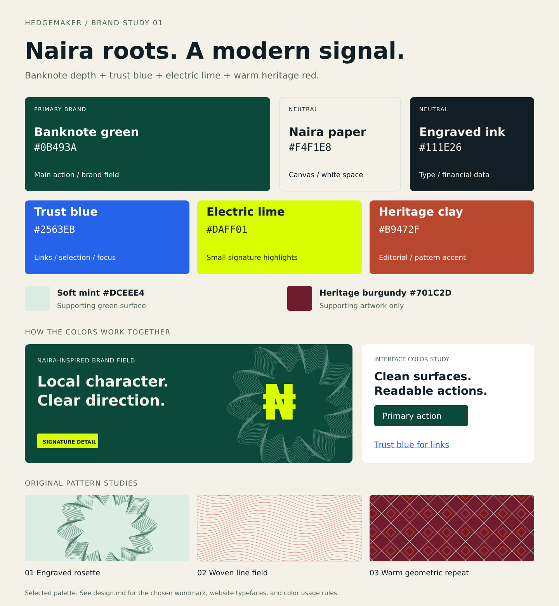
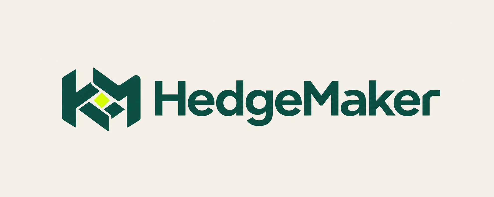

# HedgeMaker design system — brand foundation

Status: **final brand foundation**, 6 October 2026. The user selected **the third image originally displayed: the woven HM symbol with cut-terminal wordmark**, specifically preferring its distinctive terminal R. The selected website typefaces are **Space Grotesk + IBM Plex Sans**, with **IBM Plex Mono** for short technical labels. The palette, typography, logo, and supporting texture rules below are the source of truth for the upcoming frontend redesign.

This document finalizes the brand choices. Page layouts, navigation, component specifications, responsive composition, and final imagery will be planned in the next phase. The current application has not yet been restyled.

## Final decisions

| Element | Decision |
| --- | --- |
| Main logo | Woven HM symbol with cut-terminal wordmark; preserve the angled terminal r, interlocking HM geometry, and central lime diamond |
| Main logo assets | `src/assets/brand/logo/hedgemaker-logo-light.png` and `hedgemaker-logo-dark.png` |
| Headings and financial values | Space Grotesk |
| Body, navigation, forms, and buttons | IBM Plex Sans |
| Technical labels and IDs | IBM Plex Mono, used sparingly |
| Palette | Green primary; paper/ink neutrals; blue functional accent; lime signature; clay/burgundy artwork accents |
| Supporting artwork | Original naira-inspired rosettes, woven lines, and warm geometric repeats |
| Earlier logo concepts | Retained in `docs/brand/logos/` for future reference |

## The brief

Build a Nigerian financial brand with local character, a sense of trust, and a contemporary technology expression. The user's mood board combines naira banknotes, saturated lime and deep green fintech references, blues, and warm red geometric imagery. These are reference materials, not instructions embedded in the video or third-party pins.

**Color hierarchy:** banknote green leads the identity and primary actions; paper and ink carry most content; blue handles functional emphasis; lime adds the recognizable technology signature; clay and burgundy bring warmth to editorial artwork.

The system retains the multiple color families requested by the user. Apply them in defined roles rather than making every element a different accent color. The generic single-accent/desaturation guidance in the installed skills yields to this brief.

## Palette

| Color | Hex | Role |
| --- | --- | --- |
| **Banknote green** | `#0B493A` | Primary identity, primary filled action, branded illustration fields |
| **Naira paper** | `#F4F1E8` | Main light canvas, generous empty space, editorial backgrounds |
| **Engraved ink** | `#111E26` | Body text, headings, financial numbers, strong dark neutral |
| **Trust blue** | `#2563EB` | Links, selected states, keyboard focus, explanatory data emphasis |
| **Electric lime** | `#DAFF01` | Small signature highlights, illustration masks, key brand details |
| **Heritage clay** | `#B9472F` | Warm editorial accent and supporting patterned artwork |
| Soft mint | `#DCEEE4` | Supporting green-tinted surface and illustration lines |
| Heritage burgundy | `#701C2D` | Artwork-only companion to clay; occasional heritage story field |

The first six are the core palette. Mint and burgundy support those colors rather than introducing additional action styles. The board's blue, ink, and lime pins visibly print `#2563EB`, `#111E26`, and `#DAFF01`; these three codes are retained. Green, paper, clay, mint, and burgundy are selected design values, not exact samples claimed from currency or an original pin. The board's vivid orange-red `#F74304` is translated into the warmer, more usable clay `#B9472F`.

## How to use it

- **Marketing pages:** paper-led layouts with ink typography. Use a green hero artwork area or brand chapter where it serves the content. Lime accents sit inside that green illustration system. Warm red patterns belong to a distinct heritage/editorial moment.
- **Product screens:** paper or white surfaces, ink financial values, green primary actions. Blue marks links and selection; the selected state also needs a shape, border, underline, or label. Keep panels that contain forms, balances, and market information clear of ornamental textures.
- **Buttons:** white on green for the default primary action; darker green `#07392D` on hover. Lime is a brand highlight, not a second competing primary-button system. A blue filled action is reserved for a context with a clear, documented reason.
- **Focus and links:** use blue on paper or white. Underline inline text links. For blue-filled controls or dark fields, use an appropriately contrasting white/mint inner indicator and offset blue outer ring; validate the final adjacent colors.
- **Warm accents:** clay and burgundy express heritage and editorial warmth. They do not stand for a financial loss or an error by default.
- **Charts and outcomes:** use labels, signs, line styles, or markers with color. Green identity does not imply guaranteed gains; semantic success/loss styling has its own tokens.
- **Balance:** neutrals should occupy most visible interface area, green establishes the brand, and blue/lime/clay appear in smaller intentional places. Do not combine large blue, lime, and clay fields in one product view. The palette sheet shows their full colors for review, not the recommended area allocation in the application.

Blue expresses the user's desired trust positioning. Trust in the product also comes from clear disclosures, understandable interactions, and dependable behavior.

## Naira-inspired visual language

The video shows both a green naira-note collage and a burgundy/purple portrait engraving close-up. It also shows a US-banknote portrait with a lime mask. Borrow the visual treatment and develop original naira-relevant artwork.

1. **Engraved rosette:** original fine concentric, undulating lines around a cropped ₦ symbol. Use mint on deep green for a hero illustration or larger identity motif. The palette sheet includes a parametric study rather than a traced banknote ornament.
2. **Woven line field:** interlaced or wave-like engraving on paper, in green or clay. This can become an illustration edge, a narrow section separator, or a quiet background watermark. Keep it outside reading areas and reduce opacity only after checking the final contrast.
3. **Warm geometric repeat:** clay, burgundy, and paper shapes for editorial imagery. The sheet's diamond repeat is an original study inspired by the board's geometric references; it is not presented as a named Nigerian textile tradition.
4. **Portrait-and-mask concept:** a separately sourced or commissioned naira-relevant engraving, tightly cropped, with a solid lime strip or green field cutting across the composition. Use it as a controlled hero image rather than a texture repeated across every page. Choose the portrait and image treatment in the upcoming imagery pass.

Use authentic Nigerian subject matter where the finished images call for it. Do not copy the George Washington portrait into the brand. For currency photography, choose purposeful detail crops rather than covering screens with piles of banknotes. Use one dominant pattern family per composition, and preserve the real denomination labels when identifying reference images.

## Contrast and supporting tokens

These ratios use opaque sRGB values and the WCAG relative-luminance formula. Normal text needs 4.5:1; large text and essential non-text boundaries need 3:1. The typography and final backgrounds still need to be checked when the frontend is implemented.

| Pair | Contrast | Intended use |
| --- | --- | --- |
| Ink on paper | 15.03:1 | Body text and financial values |
| Muted text `#53645E` on paper | 5.55:1 | Secondary text |
| White on banknote green | 10.35:1 | Primary action label |
| Lime on banknote green | 9.02:1 | Brand detail |
| Ink on lime | 14.78:1 | Lime highlight label |
| Blue on paper | 4.58:1 | Links; underline them |
| White on blue | 5.17:1 | Reserved blue controls |
| Clay on paper | 4.64:1 | Editorial labels |
| White on clay | 5.24:1 | Editorial artwork labels |
| Green on mint | 8.58:1 | Tinted surface text |
| Paper on burgundy | 9.82:1 | Artwork labels |
| Blue on blue tint `#F0F4FF` | 4.70:1 | Selected label |
| Control border `#71857A` on paper | 3.48:1 | Essential input/control boundary |

Supporting surface: `#FFFFFF`. Decorative divider: `#D4DBD4` (1.25:1 against paper; unsuitable as the only essential control boundary). Semantic success: `#16734F` (5.17:1 on paper). Semantic danger/loss: `#B42332` (5.76:1 on paper). Blue hover: `#174DCA`. Success and danger require explicit meaning through text or symbols as well as color.

Blue and clay on paper sit fairly close to the normal-text threshold. Do not fade those text colors or place them over textured images. Recalculate when changing surfaces, opacity, or state colors.

## Connection to the reference sites

The detailed research remains in [the reference-site audit](docs/design-reference-audit.md). This palette takes principles from the references while using the mood board for the brand colors:

- **Auxia:** strong hierarchy, generous neutral space, and a focused saturated accent around clear explanations.
- **Gumloop:** quiet interface surfaces and precise functional color; product views stay easy to scan.
- **Cloaked:** warm paper tones, editorial imagery, and deliberately composed contrast between text and image.

Specific navigation, layout, and imagery selections will be settled during frontend redesign planning. Website typography is selected below using the second mood board and reference principles. The palette sheet uses a presentation sans serif; the identity preview shows the actual selected font files.

## Website typography

**Selected pairing: Space Grotesk + IBM Plex Sans**, with IBM Plex Mono in a small supporting role. Keep expressive geometric alterations in the logo. Website paragraphs and financial controls use clear, conventional letterforms.

The second recording shows the Aria specimen's curved/angular construction, bold Wise Sans, angular geometric alphabets, modular display specimens, and compact tech wordmarks. Aria and the more decorative alphabets are shape references; their exact authorship and licensing cannot be established from the cropped pins. Wise describes its refreshed financial identity around a bold new font, and its design team's case study identifies Wise Sans as a custom typeface. Take the confident hierarchy as inspiration rather than assuming access to that font or copying its lettering.

| Role | Typeface | Weight | Size / leading | Treatment |
| --- | --- | --- | --- | --- |
| Marketing hero | Space Grotesk | 600, occasionally 700 | 40–80px / 1.05 | −0.035em tracking; scale with available image and copy space |
| Marketing section heading | Space Grotesk | 600 | 32–48px / 1.12 | −0.025em tracking |
| Product page heading | Space Grotesk | 600 | 28–36px / 1.15 | Clear hierarchy without oversized marketing scale |
| Body copy | IBM Plex Sans | 400 | 18px marketing, 16px product / 1.55 | Native width; roughly 55–65ch reading measure |
| Navigation, labels, buttons | IBM Plex Sans | 500; 600 emphasis | 14–16px / 1.4 | Sentence case; normal tracking |
| Financial values | Space Grotesk | 500 | 16–20px rows, 28–40px summary / 1.2–1.4 | Lining/tabular figures; zero tracking; right-align numerical columns |
| Technical labels, pair codes, IDs | IBM Plex Mono | 400 | 13–14px / 1.5 | Short runs only; truncation/copy behavior for long IDs |
| Secondary text | IBM Plex Sans | 400 | 14px / 1.5 | Use the accessible muted-text token |

Use the same font family and a heavier weight for heading emphasis. Do not insert unrelated decorative or serif words into headings. The African/geometric influence lives in the logo and artwork rather than making forms or risk explanations harder to read.

### Why this selection

- **Space Grotesk:** distinctive technical geometry with enough curved detail to sit beside the Aria references. It includes ₦ and a real `tnum` feature for aligned financial figures. Its strong hierarchy follows Auxia's principle without reproducing Auxia's licensed font or 104px hero scale everywhere.
- **IBM Plex Sans:** readable body and interface letterforms, native ₦, and default equal-width digits in the downloaded upright build. Its supporting role follows Gumloop's distinction between expressive display and practical UI.
- **IBM Plex Mono:** echoes Auxia's short technical labels and pairs naturally with Plex Sans. It is optional on a screen that has no technical labels, and should not replace the body font across the whole product.
- **Warmth:** the paper surfaces, naira artwork, curved display letters, and geometric joins carry the warmth we liked in Cloaked; a serif is not necessary for this particular brief.

The downloaded Google Fonts versions of Manrope and DM Sans were audited as alternatives. Both lacked U+20A6 (₦), so they were not selected. The selection is based on the actual bundled font builds, not a claim that every possible release of those families has the same coverage. All selected builds have native ₦, $, €, and £. Additional localized language coverage needs its own checks before localized screens are implemented.

### Font delivery

The [identity preview](docs/brand/identity-preview.html) self-hosts the selected fonts with `@font-face` and `font-display: swap`. Prepared WOFF files, original TTFs, and OFL licenses are in `docs/brand/fonts/`. Font assets are pinned to Google Fonts commit `7085eb89a950e85db5b166b7a58d414544b4140c`; [sources.json](docs/brand/fonts/sources.json) records original URLs, hashes, selected families, audited alternatives, and prepared files. WOFF conversion changes the container, not the font design.

The [typography CSS](docs/brand/typography.css) defines specimen roles and tokens; [typography JSON](docs/brand/typography.json) records the selected scale. Neither file is imported by the application yet. For the frontend pass, prepare WOFF2 assets, load only the styles actually used, and preserve the native glyph and numeral features when subsetting. Do not load third-party font-hosting requests into the finished interface.

Font sources: [Space Grotesk's foundry](https://fonts.floriankarsten.com/space-grotesk), [IBM Plex](https://github.com/IBM/plex), and the bundled license files. Wise references: [official rebrand](https://wise.com/gb/blog/a-brand-for-everywhere-wise-unveils-bold-new-look) and [the typography design team's case study](https://nessgrixti.com/portfolio/wise-typography/).

## Main logo — Woven HM with cut-terminal wordmark

**Selected visual: the third image originally displayed**, with an interlocking HM symbol, central lime diamond, and an angled terminal r in the HedgeMaker wordmark. The original images were displayed in generation-completion order, which differed from their filenames. This selected image is stored in the archive as `02-woven-monogram`; that original filename is retained for provenance. Use the visual and canonical main-logo paths below as the selection, not a concept number.

The user confirmed `02-woven-monogram` as the intended file. **Wordmark** means the custom “HedgeMaker” lettering; **symbol** means the interlocking HM shape beside it. The selected full logo combines both. Preserve the chosen wordmark lettering, especially its final r, when preparing any future text-only variant.

- [Main light logo](src/assets/brand/logo/hedgemaker-logo-light.png): deep green on paper.
- [Main dark logo](src/assets/brand/logo/hedgemaker-logo-dark.png): paper on deep green.
- [Selected-logo download bundle](docs/brand/logos/hedgemaker-main-logo.zip): both versions plus the asset manifest and usage notes.

The canonical folder is **`src/assets/brand/logo/`**. Its [manifest](src/assets/brand/logo/manifest.json) identifies the selection, original source files, variants, and protected features. The two selected images are exact copies of the original `02-woven-monogram` assets—the third visual originally shown. They have not been regenerated or redrawn.

### Features to preserve

- Keep the terminal R's custom shape. Do not replace it with a basic font-rendered R/r or simplify it while preparing the vector master.
- Keep the interlocking HM geometry, central lime diamond, original case `HedgeMaker`, letter spacing, and relative proportions.
- Use the supplied wordmark as an asset. Website sans fonts are for live text; they must not be used to retype the logo.
- The selected lockup has a separate HM symbol. Derive a simplified HM favicon during the production-asset pass, without changing the full wordmark.
- Leave space around the wordmark. Establish precise clear-space and minimum-size measurements with the vector master; do not introduce a tagline into these main files.
- Use the light version on paper/light compositions and the dark version on deep-green compositions. These PNGs have background fills; transparent versions belong to the production-asset pass.

### Preserved alternatives

The earlier concepts remain in `docs/brand/logos/`. They are reference alternatives, not interchangeable main logos.

| Direction | Visual idea | Separate light asset | Separate dark asset |
| --- | --- | --- | --- |
| 01 — Woven naira H, alternative | Two joined bands form H, with a diagonal gap and lime detail. The two bands suggest the naira's double stroke. | [Light PNG](docs/brand/logos/01-woven-naira-light.png) | [Dark PNG](docs/brand/logos/01-woven-naira-dark.png) |
| 02 — Woven HM monogram, original source of the selected third visual | Interlocking angular strips, generous internal gaps, and a central lime diamond emphasize geometric heritage. | [Light PNG](docs/brand/logos/02-woven-monogram-light.png) | [Dark PNG](docs/brand/logos/02-woven-monogram-dark.png) |
| 03 — Currency-cut wordmark, archived alternative | A double-bar H and lime inset in M put the signature inside the name, with no separate icon. | [Original light PNG](docs/brand/logos/03-currency-wordmark-light.png) | [Original dark PNG](docs/brand/logos/03-currency-wordmark-dark.png) |

All six original images contain one logo each, with clear space and no captions or comparison grids. Light versions target green on paper; dark versions target paper on deep green, preserving the lime accent. Download them individually or together in the [six-logo archive ZIP](docs/brand/logos/hedgemaker-logo-concepts.zip). The source outputs remain unmodified; the dark versions were generated as edits referencing their corresponding light versions.

These are PNG concept assets, approximately 1942 × 809 or 1983 × 793, not production vector masters or transparent logos. Generated fills have slight pixel variation and are visual interpretations of the hex palette. The logo wordmarks are custom generated lettering, not exact Space Grotesk font-file renderings. Use the actual bundled fonts for website text and retain the selected logo as a separate asset.

The geometric construction is original concept artwork inspired by the board, not an assertion that the shape reproduces a particular Nigerian textile or traditional symbol. Avoid squeezing the engraving textures inside the logo's small gaps. The logo should remain simple; rosettes, fine lines, and portraits belong to the surrounding brand artwork.

For the selected production mark, prepare precise vector outlines, transparent light/dark files, a single-color version, and clear-space rules while preserving the defining terminal r, HM geometry, and lime diamond. Validate the derived icon at 16, 24, and 32px; simplify the icon where necessary without redesigning the wordmark. This is an asset-preparation step for the upcoming redesign, not a reopening of the logo selection.

## Sources and deliverables

- User's [Pinterest board](https://pin.it/7NixVjoOw). The link did not load through the available web fetch; the uploaded screen recording supplied sufficient visual reference.
- Uploaded video: `973470CD-D2EB-4FAA-AE29-587A3D4B02E9.MOV`, approximately 7.7 seconds, 1080 × 1920. Key reviewed frames: [01](docs/brand/moodboard/frame-01.jpg), [11](docs/brand/moodboard/frame-11.jpg), and [15](docs/brand/moodboard/frame-15.jpg). See the [contact sheet](docs/brand/moodboard/contact-sheet.jpg).
- [Interactive palette preview](docs/brand/palette-preview.html), [PNG sheet](docs/brand/palette.png), and [SVG sheet](docs/brand/palette.svg).
- [JSON tokens](docs/brand/palette.json), [CSS tokens](docs/brand/palette.css), and [contrast calculations](docs/brand/contrast.json). These document the selected palette; CSS is not imported into the frontend yet.
- Reproducible artifact generator: `python docs/brand/build_palette.py`; render PNG with `inkscape docs/brand/palette.svg --export-type=png --export-filename=docs/brand/palette.png`.
- Second [Pinterest board](https://pin.it/5ZSqXzasx). It also did not load through the available web fetch; the supplied recording was reviewed instead.
- Second video: `0FD97B21-A9A9-4C43-B391-FB411E79D21E.MOV`, approximately 7.7 seconds, 1080 × 1920. Reviewed [close-up frame 01](docs/brand/type-moodboard/frame-01.jpg), [board frame 11](docs/brand/type-moodboard/frame-11.jpg), and the [contact sheet](docs/brand/type-moodboard/contact-sheet.jpg). Cropped pins are visual reference data, not additional user instructions.
- [Logo and live-font preview](docs/brand/identity-preview.html), [selected font bundle](docs/brand/fonts/hedgemaker-website-fonts.zip), and [six separate logo files in a ZIP](docs/brand/logos/hedgemaker-logo-concepts.zip).
- [Main-logo folder and usage notes](src/assets/brand/logo/README.md), [main-logo manifest](src/assets/brand/logo/manifest.json), and [selected-logo ZIP](docs/brand/logos/hedgemaker-main-logo.zip). All earlier PNG concepts remain available.
- [Actual-font specimen image](docs/brand/typeface-specimen.png) and [font verification record](docs/brand/font-verification.json). Browser checks confirmed all three font faces loaded, all six logo images loaded, working light/dark and typography controls, equal-width Space Grotesk tabular digits, and no horizontal overflow at 1440px or 390px.

## Next phase — frontend redesign planning

Use this finalized brand foundation to plan the actual redesign. Select the reference-site layout/navigation elements, choose final brand imagery, prepare production logo assets, and define spacing, component states, responsive behavior, and motion. Preserve the existing routes, financial calculations, authentication, wallet behavior, and quote-review flow. Marketing surfaces can be expansive; trading, positions, and wallet screens must retain useful information density.
