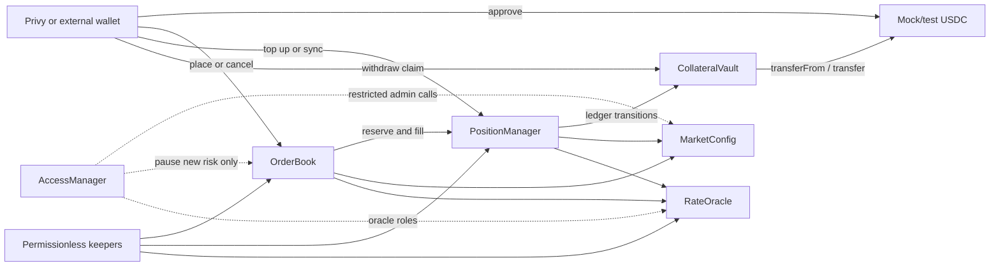

# HedgeMaker Contract Architecture Research

Status: architecture recommendation, no contracts implemented  
Reviewed: 2026-10-04  
Scope: Monad testnet V1, test USDC, bilateral collateral-limited USD/NGN forwards

This document evaluates Monad's current EVM environment, modern Ethereum standards,
and comparable protocol patterns against the financial semantics in the
[build specification](./Naira%20Forward_%20Build%20Spec.md). It recommends the
contract types to implement next. It does not replace the financial specification;
any conflict must be resolved before Solidity work begins.

## 1. Executive decision

HedgeMaker should use a **small immutable protocol of custom contracts around one
standard ERC-20 settlement asset**. Newer ERCs are useful for signatures, smart
accounts, batching, and administration, but no current standard replaces the
protocol's order reservation, isolated bilateral margin, variation settlement,
oracle challenge, and claim accounting.

Recommended V1 deployments:

1. `MockUSDC` — test-only six-decimal ERC-20 and controlled faucet.
2. `MarketConfig` — append-only, versioned economic and maturity configuration.
3. `RateOracle` — signed USD/NGN observations with proposal, challenge, resolution,
   finalization, and failure states.
4. `CollateralVault` — token custody and explicit order, fee, position, and claim
   ledgers.
5. `OrderBook` — funded fixed and pegged orders, deterministic bounded matching,
   partial fills, cancellation, and expiration.
6. `PositionManager` — isolated positions, entry marks, variation, margin calls,
   top-ups, liquidation, maturity, default, and oracle-failure closeout.
7. OpenZeppelin `AccessManager` — function-level roles and delays for the small set
   of administrative actions. This is a standard dependency, not custom financial
   logic.

Supporting internal libraries should hold exact math and validation, but should not
have their own mutable state: `ForwardMath`, `ReserveMath`, `OrderValidation`, and
`SettlementMath`.

Keepers and the event indexer are off-chain services. All keeper actions remain
permissionless, bounded, idempotent, and fully revalidated by contracts.

## 2. Why this is not an ERC-only application

ERC standards describe reusable interfaces such as fungible tokens, vault shares,
NFT ownership, signatures, and account execution. HedgeMaker's core object is
different: a funded bilateral obligation whose two collateral balances change over
time and whose outcome depends on a pinned fixing policy.

The V1 requirements that force custom state machines are:

- every unfilled order is backed by a distinct collateral and fee reserve;
- every fill creates an independently margined bilateral position;
- fixed orders bind to an oracle round, while pegged orders derive a bounded rate;
- variation is applied in finalized-round order with exact signed arithmetic;
- each side has independent equity and margin-call deadlines;
- maturity, liquidation, default, and oracle failure have deterministic precedence;
- live profit and collateral cannot be transferred or withdrawn;
- closeout creates owner-bound claims, followed by a separate withdrawal;
- no transaction may iterate over every order, position, or account.

Protocols such as 0x, Seaport, CoW Protocol, GMX, Synthetix, DIVA, UMA, Pyth,
and Chainlink provide useful patterns, but none has these exact semantics as a
drop-in contract.

## 3. Monad findings that affect the design

Monad remains EVM-compatible: Solidity atomicity, canonical transaction ordering,
reentrancy risks, and normal call semantics still apply. Parallel execution does
not create a special class of "parallel contract" that HedgeMaker must adopt.

Current official network facts list mainnet chain ID `143`, testnet `10143`, 300 ms
blocks, and 600 ms finality. Monad exposes Proposed, Voted, Finalized, and Verified
commitment states. An included receipt is not enough for irreversible off-chain
financial action; the indexer should wait for the appropriate canonical commitment,
and significant external payout logic should use Verified state.

Important implementation consequences:

- `block.timestamp` has one-second resolution, so several blocks may share a
  timestamp. Contract deadlines must use explicit `<`, `<=`, and equality rules,
  never "one block later" assumptions.
- MIP-8 warms pages of 128 consecutive storage slots. Frequently accessed fields
  should live together in order and position structs. Sequential identifiers and
  compact structs are preferable to scattered state, but packing must follow proven
  bounds rather than premature assembly optimization.
- Matching, catch-up, expiration, and settlement batches must remain bounded despite
  Monad's higher throughput and larger code limits.
- The default RPC can restrict `eth_getLogs` to short ranges. The indexer must persist
  cursors, paginate backfills, process commitment changes idempotently, and retain
  transaction submissions independently of pending-transaction RPC lookups.
- Priority gas ordering does not give fair arrival ordering or MEV protection.
  "On-chain sequence priority" must not be marketed as wall-clock fairness.
- Use official Foundry 1.8 or newer with Monad execution-network support and test
  using Monad's current storage pricing. Preserve compiler and optimizer metadata
  and verify every deployment on the selected explorer.

The official documentation currently contains some inconsistent rendered client
patch versions. Recheck the target RPC, fork activation, and tool versions immediately
before deployment rather than pinning assumptions from this research date.

Primary references:

- [Monad current facts](https://docs.monad.xyz/ai/current-facts)
- [Deployment summary](https://docs.monad.xyz/developer-essentials/summary)
- [Compatibility differences](https://docs.monad.xyz/developer-essentials/differences)
- [Block commitment states](https://docs.monad.xyz/monad-arch/consensus/block-states)
- [Gas pricing](https://docs.monad.xyz/developer-essentials/gas-pricing)
- [Opcode pricing](https://docs.monad.xyz/developer-essentials/opcode-pricing)
- [MIP-8 storage pricing](https://mips.monad.xyz/MIPs/MIP-8)
- [JSON-RPC behavior](https://docs.monad.xyz/reference/json-rpc/overview)
- [Foundry on Monad](https://docs.monad.xyz/tooling-and-infra/toolkits/foundry)

## 4. Recommended contract boundaries

### 4.1 `MockUSDC`

Use a conventional OpenZeppelin ERC-20 with exactly six decimals. It exists only
for the testnet demo and must be visibly identified as valueless test collateral.
A capped or role-controlled faucet can support onboarding without creating a real
asset claim.

Do not add transfer fees, rebasing, hooks, blacklist behavior, or unusual return
semantics to the settlement token. Those features obscure protocol accounting.
The production-facing protocol should nevertheless use `SafeERC20` and verify the
actual balance delta on deposits so an unsupported token cannot silently break the
ledger.

### 4.2 `MarketConfig`

Store append-only configuration versions containing:

- settlement token and six-decimal scale;
- lot, tick, absolute and relative strike bounds;
- initial and maintenance margin;
- order, scan, match, batch, notional, and lifetime caps;
- listed maturity/fixing identities and oracle policy hash;
- fee and gas-sponsorship policy identifiers;
- addresses of the immutable protocol components.

An active-version pointer may advance, but old versions cannot be edited. Orders
bind a version and are invalidated when that version retires; existing positions
continue under their pinned version. Pausing new exposure must not pause cancellation,
claim withdrawal, or otherwise valid defensive actions.

### 4.3 `RateOracle`

The required CBN NFEM fixing is not currently established as a standard on-chain
feed with the exact methodology in the product specification. V1 therefore needs a
narrow custom oracle rather than pretending a generic USD/NGN spot feed is equivalent.

Use EIP-712 typed observations binding at least:

- chain ID and `RateOracle` address;
- deployment, market, and config version;
- sequential round and candidate identifiers;
- observation and publication timestamps;
- signature validity deadline;
- positive six-decimal NGN/USD rate;
- source document/content hash and methodology/calendar hash.

EIP-712 provides domain separation, not replay protection. The oracle must enforce
sequence, candidate uniqueness, deadlines, and immutable finalized rounds. Expose
the domain with ERC-5267. If contract-based oracle authorities are supported, verify
through ERC-1271/OpenZeppelin `SignatureChecker` at submission time.

The state machine remains `proposed -> disputed/rejected/finalized`, with a fixed
failure deadline. Anyone may finalize an undisputed eligible candidate or submit
bounded evidence; only the disclosed resolver may adjudicate a dispute. This is a
trusted testnet oracle with transparent evidence, not a claim of trustless truth.

### 4.4 `CollateralVault`

The Vault owns the settlement tokens. `PositionManager` is its one immutable ledger
controller; no admin function may authorize a replacement controller for an existing
deployment.

Its accounting categories are explicit:

- order collateral reserve;
- unearned fee escrow;
- each side's position collateral;
- owner claimable balance;
- earned treasury fees;
- unassigned token surplus.

At every successful state transition:

`assets >= order reserves + fee escrow + position collateral + claims + earned fees`

Direct token donations become surplus, not user credit. Settlement reclassifies
position collateral into claims; withdrawal debits the owner's claim before the
external transfer and reverts atomically on failure. A failed recipient transfer
cannot block settlement or another owner's withdrawal.

This is deliberately **not ERC-4626**: there are no fungible vault shares, pooled
yield, or pro-rata ownership of assets.

### 4.5 `OrderBook`

V1 should keep funded orders on-chain and use an off-chain index for discovery.
Creation reserves collateral immediately, giving displayed liquidity a verifiable
backing. The tradeoff is more gas and capital lockup than signed off-chain quotes.

Required behavior:

- fixed and reference-pegged orders;
- exact whole lots and cumulative fill counters;
- fixed-order oracle-round binding;
- owner-protective peg rounding and offset bounds;
- best effective price followed by on-chain sequence at that price;
- deterministic self-trade prevention;
- bounded scan and match limits;
- atomic minimum-immediate-fill enforcement;
- cancel/expire only the unfilled remainder;
- cancel-and-replace rather than economic mutation in place.

The external index may sort and present depth, but the contract revalidates every
fill condition. Never allow solver-controlled arbitrary external calls near
collateral. Later signed orders may borrow 0x-style hashes, nonces, expiry, fill
counters, and cancellation, but they are not a V1 shortcut: a signature does not
prove collateral remains available.

### 4.6 `PositionManager`

This contract is the clearing state machine and sole controller of Vault accounting.
Each fill stores an isolated position with both owners, strike, notional, config,
series, entry value, last applied round/value, two equity balances, two margin-call
states, and terminal receipt fields.

It must implement:

- atomic entry-mark allocation at fill;
- ordered, once-only variation settlement;
- explicit contractual delta, paid delta, and shortfall;
- owner-authorized top-ups after processing due work;
- independent margin calls and deadlines;
- bounded `syncPosition` progress with persistent cursors;
- deterministic liquidation, maturity, default, and oracle-failure precedence;
- conversion of remaining owner equity to claims at close.

Positions are records, not ERC-721, ERC-1155, or ERC-6909 tokens. Transferability
would require rules for obligations, margin calls, claim ownership, recipient
acceptance, and regulatory treatment that V1 intentionally excludes.

### 4.7 `AccessManager`

Use OpenZeppelin's multi-contract `AccessManager` rather than bespoke ownership
checks distributed across every component. Suggested roles:

- delayed config administrator: may append/activate future versions;
- emergency pauser: may immediately block new orders/matches only;
- oracle signer manager and dispute resolver: distinct authorities;
- treasury withdrawal role: can withdraw only already-earned fee ledger amounts.

The admin should be a testnet multisig with two-step/delayed role changes. No role
can rewrite live positions, finalized oracle rounds, historical configs, user claims,
or the Vault controller. User and keeper actions use direct caller ownership; never
authorize with `tx.origin` or reject callers merely because they contain code.

## 5. Standards decision matrix

| Standard or pattern | V1 decision | Reason |
| --- | --- | --- |
| ERC-20 + OpenZeppelin `SafeERC20` | Use | Standard settlement interface with defensive transfer handling. |
| EIP-712 + ERC-5267 | Use | Typed, inspectable oracle observations bound to chain and verifier. |
| ERC-1271 / `SignatureChecker` | Use where signatures are accepted | Supports multisigs and smart accounts instead of EOA-only recovery. |
| OpenZeppelin `AccessManager` | Use | Central per-function roles and delays across the immutable suite. |
| ERC-2612 permit | Optional | Useful only if the selected token implements it; ordinary approval remains required. |
| EIP-5792 wallet calls | Conditional UX layer | Preferred way to request atomic approve-plus-place when the wallet reports support. |
| ERC-4337 | Wallet/infrastructure option | Bundlers/paymasters and batching; protocol contracts remain account-agnostic. |
| EIP-7702 | Wallet/infrastructure option | Can retain an EOA address while adding delegated execution; support must be verified. |
| EIP-1153 / transient reentrancy guard | Measure, then use if verified | Monad supports modern opcodes; transient state is suitable only for transaction-scoped locks. |
| ERC-2612/Permit2 single-call funding | Defer by default | Permit2 adds another approval target and dependency for a one-token protocol. |
| ERC-4626 | Reject for V1 | Share-based pooled vault semantics conflict with owner-bound isolated collateral. |
| ERC-721 / ERC-1155 / ERC-6909 positions | Reject for V1 | Transferable tokens misrepresent non-transferable rights and ongoing obligations. |
| ERC-1167 position clones | Reject for V1 | One deployed contract per fill increases operational complexity; structs are sufficient. |
| ERC-1967/UUPS/transparent/beacon proxies | Reject for core V1 | An upgrade key could rewrite live custody and economics; deploy new versioned suites instead. |
| ERC-2535 diamonds | Reject | Delegatecall facets and upgrade powers greatly enlarge the trusted surface. |
| Uniswap v4 hooks / AMM pools | Reject | HedgeMaker has listed bilateral series and no defensible continuous liquidity curve. |
| Generic solver/arbitrary-call settlement | Reject | External calls near escrow create approval, reentrancy, and collateral-theft surfaces. |

References:

- [ERC-20](https://eips.ethereum.org/EIPS/eip-20)
- [ERC-2612 permit](https://eips.ethereum.org/EIPS/eip-2612)
- [EIP-712](https://eips.ethereum.org/EIPS/eip-712)
- [ERC-1271](https://eips.ethereum.org/EIPS/eip-1271)
- [ERC-5267](https://eips.ethereum.org/EIPS/eip-5267)
- [ERC-4337](https://eips.ethereum.org/EIPS/eip-4337)
- [EIP-7702](https://eips.ethereum.org/EIPS/eip-7702)
- [EIP-5792](https://eips.ethereum.org/EIPS/eip-5792)
- [EIP-1153](https://eips.ethereum.org/EIPS/eip-1153)
- [ERC-4626](https://eips.ethereum.org/EIPS/eip-4626)
- [ERC-6909](https://eips.ethereum.org/EIPS/eip-6909)
- [OpenZeppelin Contracts 5 access management](https://docs.openzeppelin.com/contracts/5.x/access-control)
- [OpenZeppelin cryptography utilities](https://docs.openzeppelin.com/contracts/5.x/api/utils/cryptography)
- [OpenZeppelin security utilities](https://docs.openzeppelin.com/contracts/5.x/api/utils)
- [Uniswap Permit2](https://developers.uniswap.org/docs/protocols/permit2/overview)

## 6. Wallet and Privy boundary

The protocol should accept calls from both EOAs and smart accounts. It should not
embed Privy-specific authorization into financial contracts. Privy chooses and
operates the user's execution account; HedgeMaker records the actual asset-owning
on-chain address as the order and position owner.

Two wallet paths must not be confused:

- a separate ERC-4337 smart account can have a different address from its embedded
  signing wallet;
- an EIP-7702 integration retains the EOA address but delegates its execution code.

Before users fund, the frontend must determine which address owns assets and will
remain the caller. Gas sponsorship and batching are capabilities to verify against
the exact Monad network, Privy SDK version, bundler, paymaster, and wallet type.
Generic documentation does not prove that every combination is supported.

Preferred flow when supported: use EIP-5792/wallet batching for an atomic exact
USDC approval and `placeOrder`. Fallback flow: approve, wait for canonical receipt,
refresh allowance/rate/config/preview, then place the order. A permit approves token
spending; it is not consent to changed hedge terms.

References:

- [Privy send transaction](https://docs.privy.io/guide/react/wallets/embedded/prompts/transact)
- [Privy EIP-7702 recipe](https://docs.privy.io/recipes/react/eip-7702)
- [Privy batch transactions](https://docs.privy.io/recipes/batch-transactions)
- [Privy smart wallets](https://docs.privy.io/wallets/gas-and-asset-management/gas/ethereum)

## 7. Oracle and automation alternatives

### Recommended V1

Use the custom signed `RateOracle` with an explicitly simulated feed for the demo.
The reporter, resolver, methodology, observation schedule, challenge period,
failure deadline, and fallback are visible configuration. Maintain a shadow adapter
for real NFEM data only after endpoint, field, calendar, methodology, and licensing
are verified.

### Evaluated alternatives

- **Pyth:** `parsePriceFeedUpdatesUnique` is a strong model because it proves the
  first update inside a fixed timestamp range. No appropriate CBN NFEM USD/NGN feed
  and Monad deployment has yet been verified, so it cannot currently replace the
  custom oracle. [Pyth unique historical parsing](https://api-reference.pyth.network/price-feeds/evm/parsePriceFeedUpdatesUnique)
- **Chainlink Data Feeds:** a normal freshness check does not prove that a submitted
  historical round is the contractually selected fixing. A matching feed/methodology
  is not yet established. [Chainlink feeds](https://docs.chain.link/data-feeds/overview)
- **Chainlink CRE:** the legacy Automation product is deprecated in 2026. Current
  Chainlink releases document Monad testnet simulation support, but production
  capability, costs, and the NFEM source still require verification. CRE may later
  operate a reporter/keeper workflow; it must not become the source of contract
  authority. [Automation migration notice](https://docs.chain.link/chainlink-automation/introduction)
- **UMA OOv3:** bonds and challenges can improve dispute incentives for a published
  benchmark, but absence of a dispute is not cryptographic proof of truth. It adds
  latency, monitoring, bond, and callback risks. [UMA documentation](https://docs.uma.xyz/)

Keepers should initially be a monitored worker plus permissionless manual fallback.
No Keeper contract is necessary. The contracts independently decide whether a
round, expiration, liquidation, or closeout is eligible.

## 8. Comparable protocol lessons

- **0x:** borrow hashes, expiry, fill counters, cancellation, and explicit
  fill-or-kill behavior if signed orders are added later. Do not infer collateral
  from a signature. [0x order schema](https://docs.0xprotocol.org/en/latest/basics/orders.html)
- **Seaport:** partial fills must preserve exact divisibility across every amount.
  HedgeMaker's whole lots avoid fractional dust. [Seaport interface](https://docs.opensea.io/docs/seaport-interface)
- **CoW Protocol:** off-chain computation can be untrusted when contracts verify all
  bounds, but arbitrary solver interactions are inappropriate around long-lived
  collateral. [CoW settlement](https://docs.cow.fi/cow-protocol/reference/contracts/core/settlement)
- **GMX/Synthetix:** separate requests, oracle verification, and permissionless
  execution are useful patterns. Their pooled perpetual, cross-margin, funding, and
  liquidation systems are not V1 requirements.
- **DIVA:** opposing claims backed by a fixed collateral pool are the closest economic
  analogue. HedgeMaker differs through periodic variation, margin calls, owner-bound
  positions, and no transferable position tokens. [DIVA position lifecycle](https://docs.divaprotocol.io/diva-app/create-position-tokens)

## 9. Security invariants for implementation

These are release-blocking properties, not optional tests:

1. Vault liabilities never exceed assets.
2. Every order reserve is allocated or released exactly once.
3. Every fill conserves collateral and creates one isolated position.
4. No position can use another position's collateral.
5. Buyer and seller contractual values are exact opposites before collateral caps.
6. Rounded value deltas telescope to the rounded latest value minus entry value.
7. Every oracle round is applied to a position at most once and in sequence.
8. Terminal positions cannot accept top-ups, settle again, or reopen.
9. Claims can be withdrawn only by their owner and at most once.
10. New-risk pause does not block cancellation, withdrawal, or eligible defensive work.
11. Every loop and scan has a deployment-configured maximum.
12. Old configuration and finalized oracle data cannot be mutated by any role.
13. No user authorization relies on `tx.origin`, code-size checks, or assumed EOA status.
14. Events contain enough identities and amounts to reconstruct every ledger change.

Primary attack surfaces include double reservation, partial-fill overrun, reentrancy,
rounding dust, self-match, stale-round fills, oracle replay/cherry-picking, deadline
ties, claim double-payment, token transfer anomalies, mutable config/oracle adapters,
unbounded catch-up, and arbitrary external-call routers.

## 10. Implementation sequence after approval

No contracts should be written until the decisions below are accepted. Once they
are, implement in this order:

1. Foundry/Monad test harness and differential tests against the existing TypeScript
   reference arithmetic.
2. `MockUSDC` and exact math libraries.
3. `MarketConfig` and `RateOracle`, including state-machine and signature tests.
4. `CollateralVault`, with invariant/fuzz tests for every ledger transition.
5. `OrderBook`, including bounded-work, priority, partial-fill, and cancellation tests.
6. `PositionManager`, including chronological settlement and every terminal path.
7. Full-system invariant, adversarial, gas, and Monad fork tests.
8. Testnet deployment manifest, verified source, ABI export, keeper/indexer, and
   frontend read-only integration before enabling any write UI.

Static analysis, fuzzing, invariant testing, differential arithmetic testing, and
an independent security review are required before real-value deployment.

## 11. Decisions still required from the team

- Confirm Monad testnet `10143` as the first deployment target.
- Approve the five-contract protocol split rather than one large `ForwardEngine`.
- Approve OpenZeppelin `AccessManager` and name the testnet admin, pauser, reporter,
  resolver, treasury, and faucet authorities.
- Decide public capped faucet versus role-minted test USDC.
- Confirm the simulated oracle calendar, challenge duration, failure deadline, and
  source-hash format.
- Calibrate margins, strike/rate bounds, lot size, position/order caps, and batch caps.
- Confirm that V1 orders are fully funded on-chain and positions are non-transferable.
- Decide whether approve-plus-place batching is a launch requirement or a conditional
  enhancement after Privy/Monad capability testing.

Until those decisions are made, the correct frontend state remains read-only/demo
for protocol actions.
