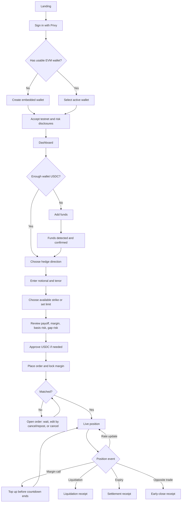

# Naira Forward — Frontend Flow, State Model, and Schemas

- Status: Product/engineering design draft
- Version: 0.1
- Last updated: 2026-10-03
- Source: [`Naira Forward_ Build Spec.md`](./Naira%20Forward_%20Build%20Spec.md)

## 1. Purpose

This document turns the build spec into an implementable frontend journey for the first demo and testnet release. It covers:

- sign-in, account recovery, and wallet creation with Privy;
- funding a wallet and locking USDC as protocol margin;
- finding the other side of a hedge through an anonymous order book;
- order placement, matching, position monitoring, top-ups, liquidation, expiry, and receipts;
- frontend routes, state machines, data ownership, TypeScript domain schemas, and contract-event mappings;
- error, loading, empty, and recovery states that must be designed alongside the happy path.

This is a UX and integration contract, not the final smart-contract ABI or visual design.

## 2. Product interpretation

### 2.1 Core promise

Naira Forward lets a user lock protection against a future move in the official USD/NGN reference rate. The contract is cash-settled in USDC; neither side buys or delivers physical USD or NGN.

### 2.2 The two sides

| Product language | Contract side | Typical user | Wants protection from |
| --- | --- | --- | --- |
| **Protect against a higher dollar** | USD buyer / long USD | Importer | Naira weakening; USD/NGN rises |
| **Protect against a lower dollar** | USD seller / short USD | Dollar earner | Naira strengthening; USD/NGN falls |

Use plain-language labels first and market terms second. Never ask a new user to choose “long” or “short” without the explanation above.

### 2.3 “Find a partner” means market matching

V1 does not expose named counterparties or a people directory. A user finds the opposite side through the order book:

1. the app shows executable opposing orders and indicative depth;
2. the user accepts an available strike or posts their own strike;
3. `OrderBook` matches compatible orders by price-time priority;
4. the resulting position shows the counterparty as an abbreviated wallet address only where technically necessary.

This keeps the frontend consistent with the financial instrument in the build spec. A later “invite a known counterparty” flow can be added as a separate RFQ feature without changing the default market.

### 2.4 Two different deposits

The word **deposit** must not describe two different balances in the same interface.

| Action | User-facing label | Destination | Spendable? | Privy’s role |
| --- | --- | --- | --- | --- |
| Add USDC to the user wallet | **Add funds** | User’s embedded or connected wallet | Yes | Displays wallet, opens supported funding route, or signs wallet actions |
| Commit USDC to a trade | **Lock margin** | Protocol `Vault` | No, until released | Prompts approval/signature and sends the contract transaction |

The wallet screen must show **Wallet balance** and **Locked as margin** as separate values. If the final `Vault` design also maintains a withdrawable protocol balance, show **Available in protocol** as a third value; do not invent that balance in the frontend before the contract supports it.

## 3. Recommended V1 product decisions

These are proposed defaults. They should be revisited after user interviews and contract design are complete.

| Decision | V1 choice | Reason |
| --- | --- | --- |
| Primary sign-in | Email OTP and Google | Familiar to non-crypto users |
| Secondary sign-in | Existing EVM wallet | Supports crypto-native judges and users |
| Wallet creation | Create an embedded EVM wallet for users without a wallet | Every authenticated user can transact without a second onboarding flow |
| Active chain | Monad testnet only | Matches the hackathon scope and reduces wrong-network risk |
| Settlement token | Test USDC configured per environment | Matches the spec; address must never be hard-coded in UI components |
| Gas | Sponsored when supported and budgeted; otherwise show MON requirement before confirmation | Prevents a hidden failure at transaction time |
| Counterparties | Anonymous price-time matching | Matches `OrderBook`; avoids profile and trust-screen scope |
| First order mode | Guided ticket with market availability; advanced order book is secondary | Better for first-time hedgers |
| Amount entry | USD notional, in configured lot increments | Matches payoff formula and contract config |
| Rates | NGN per USD | Matches the spec; always label units |
| Demo oracle | Clearly persistent “Simulated rate” badge | Required by the build spec; must not be dismissible |
| Fiat/crypto onramp | Feature-flagged, never assumed | Privy funding routes and destination networks vary; do not promise direct NGN-to-USDC-on-Monad until verified |

## 4. Information architecture

### 4.1 Public routes

| Route | Screen | Primary action |
| --- | --- | --- |
| `/` | Landing and product explanation | `Start hedging` |
| `/learn` | How the hedge, payoff, official rate, and margin work | `Try the demo` |
| `/terms` | Testnet, regulatory, basis-risk, oracle, and gap-risk disclosures | — |

### 4.2 Authenticated app routes

| Route | Screen | Primary action |
| --- | --- | --- |
| `/app` | Dashboard | `Create a hedge` |
| `/app/market` | Market availability and order book | `Build hedge` |
| `/app/orders/new` | Guided order ticket | `Review order` |
| `/app/orders/:orderId` | Open/partial/filled/cancelled order | `Cancel remaining` |
| `/app/positions/:positionId` | Live position | `Add margin` |
| `/app/wallet` | Balances, add funds, activity | `Add funds` |
| `/app/activity` | Transactions, settlements, and receipts | View detail |
| `/app/receipts/:receiptId` | Human-readable outcome | `View on explorer` |
| `/app/settings` | Identity, wallets, security, disclosures | Manage account |

On mobile, the persistent navigation should be `Home`, `Market`, `Positions`, and `Wallet`. Urgent margin calls override the normal header with a persistent alert.

## 5. End-to-end happy path



## 6. Detailed user flows

### 6.1 App boot and route guard

1. Render a neutral app shell while Privy initializes.
2. Wait for both authentication state and wallets to report ready.
3. If the route is public, render it regardless of authentication.
4. If the route is protected and the user is signed out, preserve the intended destination and open the sign-in flow.
5. If authenticated but no wallet is ready, show “Setting up your wallet” rather than an empty dashboard.
6. If authenticated and the active wallet is on the wrong network, show a blocking network repair card before allowing a write action.
7. Resume the intended destination after authentication and wallet readiness.

Do not flash the signed-out view before Privy initialization completes.

### 6.2 Sign-up, sign-in, and returning login

#### New user

1. User selects `Start hedging`.
2. Privy modal offers email, Google, and wallet login.
3. After successful authentication, Privy creates an embedded EVM wallet only if the user does not already have one.
4. The app selects the usable Monad wallet as the active wallet.
5. The app creates/updates its off-chain `UserProfile`, keyed by Privy DID—not by email or wallet address.
6. The user accepts:
   - testnet-only notice;
   - simulated-rate notice when demo mode is active;
   - official-rate basis-risk notice;
   - margin and liquidation notice.
7. The app routes to the dashboard and highlights the next incomplete task: add funds or create a hedge.

#### Returning user

1. Wait for Privy readiness.
2. Restore the session and active wallet.
3. Reconcile indexed protocol balances and positions against the wallet address.
4. Route directly to the dashboard unless the user arrived through a deep link.
5. If a margin call is active, open the position with the urgent alert visible.

#### Account recovery and wallet changes

- Privy owns authentication recovery for embedded wallets.
- A user may link more login methods from settings.
- Changing the active wallet must trigger a complete refetch of balances, orders, positions, allowances, and activity.
- Never merge protocol records across two wallet addresses merely because they share a Privy user.
- Wallet export, if enabled later, belongs in Security and requires a strong warning; it is not part of the demo path.

### 6.3 Wallet funding — “Add funds”

#### Entry points

- dashboard setup card;
- wallet screen;
- insufficient-funds state on the order review;
- insufficient-funds state on margin top-up.

#### Flow

1. Show the required amount, current wallet USDC, and shortfall.
2. Offer only methods enabled and verified for the current environment:
   - **Receive USDC:** copy address/QR and show exact network and token;
   - **Privy funding route:** open Privy’s deposit/funding UI only if the target asset and chain route is supported;
   - **Testnet faucet:** demo/testnet only;
   - **Bridge:** link to an approved route only after it is selected and tested.
3. Keep the funding task in a `waiting_for_funds` state after an address is shown or an external provider is opened.
4. Watch indexed transfers and refresh the onchain ERC-20 balance.
5. Require the configured confirmation policy before declaring success.
6. Return to the interrupted order or top-up flow with the entered values preserved.

#### Important integration constraint

Privy’s current deposit UI supports configurable fiat and crypto funding, but direct destination support depends on the provider, asset, and chain. Monad must be treated as a verified configuration requirement, not an assumption. For the hackathon fallback, use faucet USDC or a tested bridge/receive flow.

### 6.4 Discover market / find the opposite side

The market screen answers “Can I get this hedge?” before asking the user to fill a dense ticket.

1. User chooses one of two intent cards:
   - `I need dollars later` → protect against a higher dollar → USD buyer;
   - `I earn in dollars` → protect against a lower dollar → USD seller.
2. User chooses tenor: 7, 14, or 30 days, subject to `MarketConfig`.
3. Show:
   - latest official/simulated rate and publication time;
   - best available opposite strike;
   - available notional at that strike;
   - additional depth by strike;
   - estimated initial margin;
   - “No available match” empty state with `Set your rate` action.
4. Selecting liquidity pre-fills the order ticket as a crossing limit order.
5. The review screen explains whether the order is expected to fill immediately, partially, or remain open.

Do not label an indicative result “guaranteed.” Re-check the order book immediately before submission and tolerate onchain state changes.

### 6.5 Build and submit an order

#### Ticket fields

| Field | Source | Validation |
| --- | --- | --- |
| Hedge direction | User intent | Required |
| Notional USD | User input | Positive; multiple of lot size; within market min/max |
| Tenor / expiry | `MarketConfig` | One of enabled tenors; not expired |
| Strike NGN/USD | Book selection or user limit | Positive; market tick size; sensible deviation warning |
| Required initial margin USDC | Derived from contract config | Read-only |
| Maintenance margin USDC | Derived from contract config | Read-only |
| Estimated available match | Indexed order book | Indicative, refreshed before send |
| Maximum loss | Contract/risk rules | Plain-language disclosure |

#### Review hierarchy

1. **You are protecting:** one-sentence intent summary.
2. **You lock today:** exact USDC initial margin.
3. **Your rate:** strike and official-rate source.
4. **What happens when the rate moves:** two worked outcomes, one favorable and one unfavorable.
5. **What can happen to your deposit:** variation settlement, maintenance threshold, grace period, liquidation.
6. **Not covered:** P2P/parallel-market basis risk and loss beyond posted margin.
7. **Execution expectation:** immediate, partial, or resting.

#### Transaction sequence

1. Refresh allowance, wallet USDC, market status, and best opposite order.
2. If allowance is below the required margin, request an exact or policy-approved USDC allowance for `Vault`.
3. Wait for the approval receipt.
4. Submit `placeOrder(...)` through the active Privy wallet.
5. Show explicit transaction stages: `Confirm in wallet` → `Submitted` → `Confirmed` → `Indexed`.
6. Read the confirmed receipt/events to identify the created order and any resulting positions.
7. Route to:
   - position when fully matched;
   - order detail when unmatched;
   - combined result when partially matched.

Never infer success from a transaction hash alone.

### 6.6 Open and partially filled orders

The order detail screen shows original notional, filled notional, remaining notional, strike, expiry, locked margin, queue time, and resulting positions.

Allowed V1 actions:

- cancel remaining notional;
- add wallet funds (does not change the order by itself);
- inspect each matched position;
- replace the order through `Cancel and create new`, implemented as two visible transactions unless the contract supports an atomic replace.

Cancellation must state how much margin is expected to unlock. The UI waits for contract confirmation before showing the balance as available.

### 6.7 Live position

The position screen follows the build spec and makes risk legible:

- user side and plain-language intent;
- notional, strike, current rate, expiry, and next update expectation;
- running settled gain/loss and latest settlement delta;
- **your margin** bar with maintenance threshold;
- **counterparty margin** bar;
- wallet USDC and protocol-available USDC;
- event timeline: match, rate settlements, top-ups, margin calls, liquidation/expiry;
- persistent simulated-rate badge in demo mode;
- `Add margin` primary action when risk is elevated.

Margin bars must use numerical labels in addition to color. A safe/at-risk/liquidatable state cannot rely on red and green alone.

### 6.8 Margin call and top-up

1. A `MarginCallOpened` event or derived maintenance breach changes the position status to `margin_call`.
2. Show a persistent in-app alert and countdown based on the onchain deadline.
3. The top-up sheet defaults to “restore initial margin” and also allows a custom amount.
4. Show wallet balance and shortfall before confirmation.
5. If the wallet is underfunded, route through Add funds and return to the same top-up sheet.
6. If token allowance is insufficient, approve USDC.
7. Submit `addMargin(positionId, amount)`.
8. On confirmation, refresh the onchain position and clear the warning only when the contract state says the margin call is resolved.

The countdown is informational; the chain timestamp and contract state are authoritative. If the deadline passes while the sheet is open, disable top-up if the contract no longer permits it and refresh the position.

### 6.9 Liquidation, expiry, and early close

#### Liquidation

- Show `Position closed: margin was not restored before the deadline`.
- Present final transferred amount, remaining returned amount, liquidation reward if relevant, transaction link, and one-sentence reason.
- Never show this as a generic transaction failure.

#### Expiry

- After the final fixing and settlement, show strike, final official rate, cumulative settlements, released margin, and final wallet/protocol balances.
- If the official rate is late or disputed, show `Awaiting final rate` or `Market under review`, not “expired and paid.”

#### Early close

- V1 closes economically by placing the opposite trade, as specified.
- The UI must label the quote as an **offsetting order**, not imply a guaranteed instant close.
- Until the offset fills and contract state confirms closure/netting, the original position remains at risk.

### 6.10 Receipt

Every terminal action gets a shareable, deterministic receipt:

- outcome: filled, cancelled, topped up, liquidated, expired, early-close fill, or voided;
- one-sentence explanation;
- actor wallet, market, position/order ID, and timestamp;
- relevant rate(s), notional, strike, and amounts moved;
- transaction hash and explorer link;
- `Simulated rate` label when applicable.

Example: “The official USD/NGN rate rose above your ₦1,650 strike, so 8.42 USDC was moved from the seller’s margin to your protocol balance.”

## 7. Screen contracts

Each screen should be implemented against an explicit state contract.

| Screen | Required data | Loading state | Empty/error state | Write action |
| --- | --- | --- | --- | --- |
| Landing | market summary, demo mode | skeleton only for live rate | rate unavailable banner | Privy login |
| Dashboard | wallet, balances, orders, positions, alerts | private app shell | first-use checklist; indexer stale | none |
| Market | config, latest rate, order-book levels | depth skeleton | no liquidity; market paused | none |
| Order ticket | config, book quote, balances, allowance | preserve form | invalid lot; insufficient funds; stale quote | approve, place order |
| Order detail | order, fills, linked positions | status skeleton | order not found/wrong wallet | cancel |
| Position | position, margin, rates, events | last known data + refresh marker | oracle late/disputed; indexer stale | top up, offset |
| Wallet | active wallet, token/native balances, protocol balances | balance skeleton | unsupported funding route | add funds |
| Receipt | finalized event data | confirming/indexing stages | re-query by tx hash | none |

## 8. Frontend state machines

### 8.1 Authentication and wallet readiness

```text
booting
  -> signed_out
  -> authenticating
  -> authenticated_wallet_loading
  -> wallet_ready
  -> wrong_network
  -> wallet_error
```

Guards:

- `ready === false` always maps to `booting`.
- Protected routes require `authenticated && activeWallet`.
- Contract writes additionally require correct chain, sufficient native gas unless sponsored, and an unpaused market.

### 8.2 Transaction lifecycle

```text
idle
  -> preparing
  -> awaiting_user_confirmation
  -> submitted
  -> confirmed
  -> indexed

Any non-terminal state may become:
  -> rejected
  -> reverted
  -> dropped_or_replaced
  -> indexing_delayed
```

`confirmed` is chain truth. `indexed` means the read model has caught up. The interface can show confirmed success while separately retrying indexing.

### 8.3 Order lifecycle

```text
draft -> approving -> submitting -> open -> partially_filled -> filled
                                     |            |
                                     +----------> cancelling -> cancelled
                                     |
                                     +----------> expired
```

### 8.4 Position lifecycle

```text
open -> margin_call -> open
  |          |
  |          +-> liquidatable -> liquidated
  +-> closing -> closed_early
  +-> awaiting_final_fixing -> expired
  +-> voided
```

The exact enum must follow the contracts. The frontend must not invent a terminal status from timestamps alone.

## 9. Data ownership and synchronization

| Data | System of record | Frontend access |
| --- | --- | --- |
| Authentication identity/session | Privy | React SDK; verified access token on backend |
| Wallet address and wallet type | Privy + wallet provider | Privy wallet hooks |
| Wallet USDC and MON balances | Monad | RPC/indexer |
| Market config | `MarketConfig` | Contract read/indexer |
| Orders and fills | `OrderBook` | Indexed events + contract verification |
| Positions and margin | `PositionManager` / `Vault` | Indexed events + contract reads |
| Official/simulated rate status | `RateOracle` | Indexed events + contract reads |
| User preferences/disclosure versions | App database | Authenticated API |
| Human-readable receipts | Derived from confirmed onchain events | App API/client formatter |

The indexer is a query accelerator, not the financial source of truth. For write completion and urgent margin state, reconcile against the transaction receipt and contract reads.

## 10. Domain schemas

The following TypeScript types are the proposed frontend domain model. Integer token amounts are serialized as decimal strings at API boundaries to avoid JavaScript precision loss.

```ts
type Address = `0x${string}`;
type Hex = `0x${string}`;
type UnixSeconds = number;
type DecimalString = string;

type ChainRef = {
  chainId: number;
  caip2: `eip155:${number}`;
  name: string;
  explorerUrl: string;
};

type AppMode = 'demo' | 'testnet' | 'production';
type HedgeSide = 'USD_BUYER' | 'USD_SELLER';
type WalletKind = 'privy_embedded' | 'external';

interface UserProfile {
  id: string;
  privyDid: string;
  displayName?: string;
  onboardingState: 'new' | 'disclosures_pending' | 'complete';
  acceptedDisclosureVersion?: string;
  acceptedDisclosureAt?: string;
  createdAt: string;
  updatedAt: string;
}

interface WalletAccount {
  address: Address;
  privyWalletId?: string;
  kind: WalletKind;
  chainType: 'ethereum';
  isActive: boolean;
}

interface TokenAmount {
  token: Address;
  symbol: 'USDC' | 'MON' | string;
  decimals: number;
  raw: DecimalString;
  formatted: string;
}

interface AccountBalances {
  walletUsdc: TokenAmount;
  walletNative: TokenAmount;
  /** Present only if Vault implements a withdrawable free balance. */
  protocolAvailableUsdc?: TokenAmount;
  lockedMarginUsdc: TokenAmount;
  asOfBlock: DecimalString;
}

interface MarketConfigView {
  marketId: string;
  baseSymbol: 'USD';
  quoteSymbol: 'NGN';
  settlementToken: Address;
  settlementTokenDecimals: number;
  lotSizeUsd: DecimalString;
  tickSizeNgnPerUsd: DecimalString;
  allowedTenorDays: number[];
  initialMarginBps: number;
  maintenanceMarginBps: number;
  gracePeriodSeconds: number;
  isPaused: boolean;
  mode: AppMode;
  contractAddresses: {
    marketConfig: Address;
    orderBook: Address;
    positionManager: Address;
    vault: Address;
    rateOracle: Address;
  };
}

interface RateSnapshot {
  marketId: string;
  roundId: DecimalString;
  rateNgnPerUsd: DecimalString;
  sourceLabel: string;
  sourceRef: string;
  observedAt: UnixSeconds;
  postedAt: UnixSeconds;
  disputeEndsAt?: UnixSeconds;
  status: 'pending' | 'active' | 'disputed' | 'superseded' | 'voided';
  isSimulated: boolean;
  txHash: Hex;
  blockNumber: DecimalString;
}

interface OrderBookLevel {
  side: HedgeSide;
  strikeNgnPerUsd: DecimalString;
  availableNotionalUsd: DecimalString;
  orderCount: number;
}

type OrderStatus =
  | 'open'
  | 'partially_filled'
  | 'filled'
  | 'cancelling'
  | 'cancelled'
  | 'expired';

interface OrderView {
  orderId: DecimalString;
  marketId: string;
  owner: Address;
  side: HedgeSide;
  strikeNgnPerUsd: DecimalString;
  originalNotionalUsd: DecimalString;
  filledNotionalUsd: DecimalString;
  remainingNotionalUsd: DecimalString;
  expiryAt: UnixSeconds;
  marginLockedUsdc: DecimalString;
  status: OrderStatus;
  createdTxHash: Hex;
  createdAt: UnixSeconds;
  updatedAt: UnixSeconds;
}

interface FillView {
  fillId: string;
  orderId: DecimalString;
  positionId: DecimalString;
  maker: Address;
  taker: Address;
  notionalUsd: DecimalString;
  strikeNgnPerUsd: DecimalString;
  txHash: Hex;
  blockNumber: DecimalString;
  filledAt: UnixSeconds;
}

type PositionStatus =
  | 'open'
  | 'margin_call'
  | 'liquidatable'
  | 'closing'
  | 'closed_early'
  | 'awaiting_final_fixing'
  | 'expired'
  | 'liquidated'
  | 'voided';

interface MarginState {
  postedUsdc: DecimalString;
  currentUsdc: DecimalString;
  maintenanceRequiredUsdc: DecimalString;
  initialRequiredUsdc: DecimalString;
  healthBps: number;
  callOpenedAt?: UnixSeconds;
  callDeadline?: UnixSeconds;
}

interface PositionView {
  positionId: DecimalString;
  marketId: string;
  longWallet: Address;
  shortWallet: Address;
  viewerSide: HedgeSide;
  notionalUsd: DecimalString;
  strikeNgnPerUsd: DecimalString;
  openedAt: UnixSeconds;
  expiryAt: UnixSeconds;
  lastSettledRoundId?: DecimalString;
  lastSettledRateNgnPerUsd?: DecimalString;
  viewerCumulativePnlUsdc: DecimalString;
  longMargin: MarginState;
  shortMargin: MarginState;
  status: PositionStatus;
}

interface SettlementView {
  settlementId: string;
  positionId: DecimalString;
  roundId: DecimalString;
  previousValueUsdc: DecimalString;
  currentValueUsdc: DecimalString;
  deltaUsdc: DecimalString;
  payer: Address;
  receiver: Address;
  txHash: Hex;
  settledAt: UnixSeconds;
}

type ActivityKind =
  | 'wallet_funded'
  | 'token_approved'
  | 'order_placed'
  | 'order_partially_filled'
  | 'order_filled'
  | 'order_cancelled'
  | 'variation_settled'
  | 'margin_call_opened'
  | 'margin_added'
  | 'position_liquidated'
  | 'position_expired'
  | 'position_closed_early'
  | 'market_voided';

interface ActivityItem {
  id: string;
  wallet: Address;
  kind: ActivityKind;
  status: 'pending' | 'confirmed' | 'failed';
  orderId?: DecimalString;
  positionId?: DecimalString;
  amountUsdc?: DecimalString;
  rateNgnPerUsd?: DecimalString;
  txHash?: Hex;
  occurredAt: UnixSeconds;
  title: string;
  description: string;
}

interface ReceiptView {
  receiptId: string;
  kind: ActivityKind;
  headline: string;
  explanation: string;
  wallet: Address;
  orderId?: DecimalString;
  positionId?: DecimalString;
  marketId: string;
  notionalUsd?: DecimalString;
  strikeNgnPerUsd?: DecimalString;
  fixingRateNgnPerUsd?: DecimalString;
  amountMovedUsdc?: DecimalString;
  amountReleasedUsdc?: DecimalString;
  isSimulatedRate: boolean;
  txHash: Hex;
  occurredAt: UnixSeconds;
}
```

## 11. Form and command schemas

These types are UI/API commands. The backend may prepare calldata, but the authenticated active wallet must authorize user-initiated writes.

```ts
interface OrderDraft {
  marketId: string;
  side: HedgeSide;
  notionalUsd: DecimalString;
  tenorDays: number;
  strikeNgnPerUsd: DecimalString;
}

interface OrderPreview extends OrderDraft {
  expiryAt: UnixSeconds;
  initialMarginUsdc: DecimalString;
  maintenanceMarginUsdc: DecimalString;
  walletUsdc: DecimalString;
  allowanceUsdc: DecimalString;
  expectedImmediateFillUsd: DecimalString;
  expectedRestingUsd: DecimalString;
  quoteBlockNumber: DecimalString;
  warnings: Array<
    | 'INSUFFICIENT_WALLET_USDC'
    | 'APPROVAL_REQUIRED'
    | 'NO_IMMEDIATE_MATCH'
    | 'PARTIAL_FILL_EXPECTED'
    | 'RATE_STALE'
    | 'LARGE_STRIKE_DEVIATION'
  >;
}

interface PlaceOrderCommand extends OrderDraft {
  expiryAt: UnixSeconds;
  maxInitialMarginUsdc: DecimalString;
  quoteBlockNumber: DecimalString;
}

interface AddMarginCommand {
  positionId: DecimalString;
  amountUsdc: DecimalString;
}

interface CancelOrderCommand {
  orderId: DecimalString;
}
```

Server endpoints that return prepared calldata must re-derive and validate market config. The frontend-supplied margin, status, or expected fill is never trusted as authorization.

## 12. Contract events to frontend updates

Final event names depend on the smart contracts; this is the required semantic mapping.

| Contract event meaning | Update |
| --- | --- |
| Order placed | Insert/open `OrderView`; increase locked margin |
| Order matched/filled | Reduce remaining order; create `FillView` and `PositionView` |
| Order cancelled | Mark cancelled; refresh available/locked balances |
| Rate posted | Update `RateSnapshot`; show dispute window/state |
| Variation settled | Append `SettlementView`; update both margin bars and cumulative PnL |
| Margin call opened | Set status and deadline; raise urgent alert |
| Margin added | Refresh margin and allowance/balances; resolve alert only if contract does |
| Position liquidated | Set terminal state; create receipt |
| Position expired | Set terminal state after final settlement; create receipt |
| Market voided | Mark affected orders/positions; show returned margin receipt |

Indexer records should be uniquely constrained by `chainId + txHash + logIndex` so replays are idempotent and chain reorganizations can be handled.

## 13. Privy integration blueprint

### 13.1 SDK boundary

Use Privy for:

- email/social/wallet authentication;
- embedded EVM wallet creation and recovery;
- enumerating and selecting connected wallets;
- prompting user-authorized EVM transactions;
- optional funding UI where the desired Monad/USDC route has been verified;
- access tokens for authenticated app API requests.

Use Monad contracts/RPC/indexing for:

- USDC and MON balances;
- allowances;
- orders, fills, positions, margin, oracle state, and receipts;
- transaction confirmation and reverts.

Privy is not the ledger for protocol margin or positions.

### 13.2 Provider configuration

Conceptual configuration, to be pinned to the installed SDK version during implementation:

```tsx
<PrivyProvider
  appId={env.NEXT_PUBLIC_PRIVY_APP_ID}
  clientId={env.NEXT_PUBLIC_PRIVY_CLIENT_ID}
  config={{
    loginMethods: ['email', 'google', 'wallet'],
    embeddedWallets: {
      ethereum: {createOnLogin: 'users-without-wallets'}
    },
    defaultChain: monadTestnet,
    supportedChains: [monadTestnet]
  }}
>
  {children}
</PrivyProvider>
```

Rules:

- Define Monad from the installed `viem/chains` version or with `defineChain` using official network data.
- Configure `defaultChain` and `supportedChains`; do not rely on Privy defaults.
- Use separate Privy app clients and environment variables for local, preview, and production environments.
- Wait for `usePrivy().ready` and wallet readiness before consuming session or wallet state.
- Select an active wallet explicitly when more than one wallet is present.

### 13.3 Wallet writes

Use Privy’s current React transaction interface to send encoded contract calls from the active address. The app should maintain one transaction coordinator so approval, order, cancellation, and margin writes share the same lifecycle and error handling.

```ts
const {sendTransaction} = useSendTransaction();

const result = await sendTransaction(
  {to: contractAddress, data: encodedCallData, value: 0n, chainId},
  {address: activeWallet.address, sponsor: gasSponsorshipEnabled}
);
```

If the final contract supports ERC-2612 permit, Permit2, batching, or account abstraction on the selected Monad environment, approval + action may be combined later. The baseline flow assumes a visible two-transaction ERC-20 approval and contract call.

### 13.4 Backend authentication

1. Frontend gets the current Privy access token.
2. It sends the token as a bearer token, or uses the configured HTTP-only cookie mode.
3. Backend verifies the token and uses the Privy DID (`sub`) as the app-user key.
4. Backend authorizes wallet-scoped data by checking the wallet is linked/owned as expected and by validating addresses against the request.
5. Contract writes remain wallet-authorized; possession of an app session alone is not permission to move funds.

### 13.5 Delegated/server-side wallet actions

Do not enable delegated signing for the V1 user flow by default. It expands the trust and policy surface and is unnecessary for explicit user actions such as orders and top-ups. Automation should occur in protocol contracts or a permissionless keeper where possible.

If delegated actions are later required, define narrow Privy policies for allowed contracts, methods, chains, token amounts, and expiry; collect explicit user consent; and document revocation.

## 14. Validation and safety rules

- Never use JavaScript `number` for token raw amounts, notional units, rates, or IDs; use `bigint` internally and decimal strings over JSON.
- Derive margin from contract config, then verify it again immediately before sending.
- Display token symbol, network, and destination on every approval or transfer confirmation.
- Default approvals to the required amount where practical; if using unlimited allowance, disclose it and provide revoke guidance.
- Disable writes when the market is paused, oracle state is disputed/voided, the chain is wrong, or app configuration does not match deployed contract addresses.
- Treat wallet rejection as a normal cancelled action, not a system error.
- Surface contract revert reasons in user language while retaining a diagnostic code.
- Persist unsent order drafts locally, but never persist access tokens or secrets in app state logs.
- Redact emails and full wallet addresses from analytics.
- Show rate source, timestamp, status, and demo label anywhere the current rate drives a financial number.
- Recalculate countdowns from chain/server time periodically; do not trust the user’s device clock alone.

## 15. Error and recovery catalogue

| Condition | User message | Recovery |
| --- | --- | --- |
| Privy not ready | “Loading your secure session…” | Wait; offer refresh only after timeout |
| Login cancelled | No destructive toast | Stay on current page |
| Wallet setup failed | “We couldn’t finish setting up your wallet.” | Retry; connect external wallet |
| Wrong network | “Switch to Monad testnet to continue.” | Privy/wallet switch action |
| Insufficient USDC | “You need X more USDC.” | Add funds |
| Insufficient gas | “You need MON for network fees.” | Faucet/add MON, or retry with sponsorship |
| Approval rejected | “Approval was cancelled. No funds moved.” | Retry |
| Quote/book changed | “Available liquidity changed before submission.” | Refresh preview and reconfirm |
| Transaction reverted | Plain-language contract reason | Correct inputs or retry |
| Transaction confirmed, indexer late | “Confirmed onchain; updating your dashboard.” | Poll receipt/contract; explorer link |
| Rate late | “Today’s official rate has not been posted.” | Keep position state; explain fallback |
| Rate disputed | “This rate is under review; settlement is paused.” | Show dispute status |
| Top-up deadline passed | “The top-up window has closed.” | Refresh position; show liquidation state |
| Unsupported funding route | “Direct funding is unavailable for this network.” | Show address/faucet/approved bridge |

## 16. Analytics events

Analytics should measure funnel friction without recording sensitive financial payloads.

```text
landing_cta_clicked
login_started
login_completed { method, isNewUser }
wallet_ready { walletKind }
disclosures_accepted { version }
funding_started { method }
funding_completed { method }
hedge_intent_selected { side }
market_liquidity_selected { tenorDays }
order_previewed { side, tenorDays, hasImmediateFill }
approval_started / approval_confirmed / approval_failed
order_submitted / order_confirmed / order_indexed
order_cancelled
position_viewed { status }
margin_call_viewed
margin_topup_started / margin_topup_confirmed
receipt_viewed { kind }
```

Do not send email, full wallet address, raw balances, exact notional, or transaction calldata to product analytics.

## 17. Demo flow mapped to the build spec

| Shot | Frontend action | Required seeded state |
| --- | --- | --- |
| 1 | Ada and Bayo sign in, see funded embedded wallets, and submit opposite orders | Two demo identities, test USDC, test MON or sponsorship |
| 2 | Orders match; position screen opens with two margin bars | Compatible strike, tenor, and lot |
| 3 | Simulated rate update moves margin from Ada to Bayo | Demo oracle control outside normal user UI |
| 4 | Margin call banner and countdown appear; Ada tops up | Rate causes maintenance breach, grace period long enough to narrate |
| 5 | Second sharp move and elapsed grace lead to liquidation | Keeper/liquidation action available |
| 6 | Receipt explains final amounts and reason | Indexed liquidation event and explorer link |

The `Simulated rate` label stays visible in every shot involving rates, PnL, or settlement.

## 18. Implementation slices

### Slice 1 — Shell, Privy, and read-only dashboard

- configure Privy provider and Monad testnet;
- implement login/logout, embedded wallet creation, active wallet selection, and protected routes;
- add disclosure gate;
- show wallet address and balances;
- define environment-safe contract and token configuration.

### Slice 2 — Funding and order discovery

- wallet screen and receive/faucet flow;
- feature-flagged Privy funding route;
- market config, rate banner, and aggregated order-book levels;
- intent-first market discovery.

### Slice 3 — Order ticket and execution

- draft validation and order preview;
- USDC approval;
- place/cancel order transaction coordinator;
- open, partial, filled, and cancelled order screens.

### Slice 4 — Positions and margin

- position detail and margin bars;
- rate settlement timeline;
- margin-call alert/countdown;
- add-margin flow.

### Slice 5 — Terminal states and demo polish

- liquidation, expiry, early-close, and void receipts;
- indexer-delay recovery;
- seeded two-user demo path;
- responsive and accessibility pass;
- analytics and error instrumentation.

## 19. Acceptance criteria for the frontend flow

- A first-time user can sign in without already owning a crypto wallet.
- An embedded wallet is created only when the user lacks a usable wallet.
- A user always knows whether USDC is in their wallet, available in the protocol, or locked as margin.
- The interface never implies that adding funds and locking margin are the same action.
- A user can express their real-world hedge intent without knowing “long” or “short.”
- The market screen communicates available opposite liquidity without exposing named counterparties.
- Before an order is signed, the user sees strike, notional, tenor, initial margin, maintenance margin, execution expectation, basis risk, and gap risk.
- Transaction status distinguishes submitted, confirmed, and indexed.
- A partial fill is never shown as a fully matched hedge.
- A margin call includes an onchain-derived deadline and a top-up path that preserves context through funding.
- Demo/simulated rates are unmistakably labelled.
- Liquidation and expiry produce a one-sentence human-readable receipt with onchain evidence.
- Wrong-network, insufficient-USDC, insufficient-gas, rejected-wallet, stale-book, disputed-rate, and delayed-indexer states all have designed recovery paths.

## 20. Open product and contract decisions

These answers will change copy, calculation, or state transitions and should be resolved before high-fidelity UI work:

1. Are unmatched orders allowed to rest until expiry, or do they have a separate order deadline?
2. Can one order create multiple positions, and can a position be partially closed/netted onchain?
3. Does `placeOrder` pull initial margin directly into `Vault`, or must users first deposit into a protocol balance?
4. Is margin tracked per position or shared across positions?
5. Does the contract support permit/batching, or should V1 design for approve + action?
6. Is liquidation permissionless or platform-operated, and how is the reward displayed?
7. What exact rule resolves a margin call after top-up—initial margin, maintenance margin, or another target?
8. What are the final lot size, tick size, tenors, margin percentages, grace period, and confirmation policy?
9. Which test USDC contract and faucet/bridge route will the demo use?
10. Will gas be sponsored for embedded wallets on the chosen Monad environment?
11. Does the rate dispute window delay each settlement or only finalization?
12. What privacy policy applies to addresses and transaction history associated with Privy identities?

## 21. Reference links

- [Privy React SDK setup](https://docs.privy.io/basics/react/setup)
- [Privy EVM network configuration](https://docs.privy.io/basics/react/advanced/configuring-evm-networks)
- [Privy automatic embedded wallet creation](https://docs.privy.io/basics/react/advanced/automatic-wallet-creation)
- [Privy deposit modal](https://docs.privy.io/wallets/funding/use-deposit-funds)
- [Privy access tokens](https://docs.privy.io/authentication/user-authentication/access-tokens)
- [Privy send transaction](https://docs.privy.io/wallets/using-wallets/ethereum/send-a-transaction)
- [Monad network information](https://docs.monad.xyz/developer-essentials/network-information)
