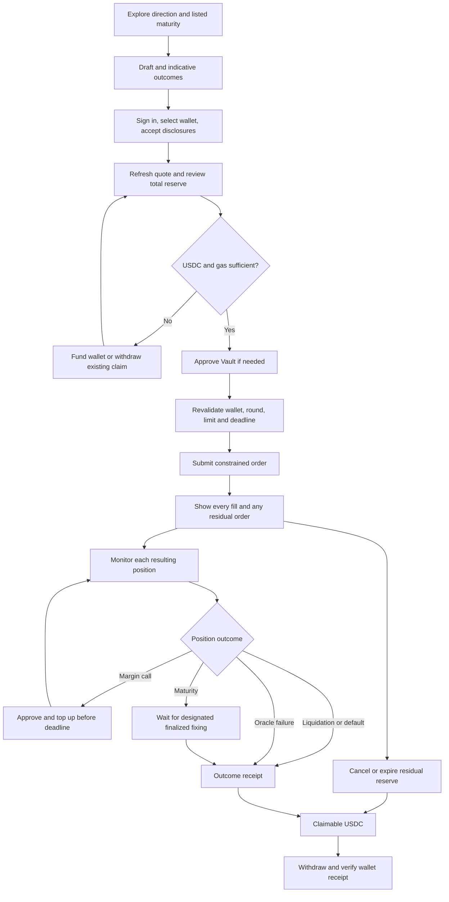

# Naira Forward — Frontend Flow, State Model, and Schemas

- Status: Audited product/engineering design draft; implementation pending
- Version: 0.3
- Last updated: 2026-10-03
- Financial source: [Build spec](./Naira%20Forward_%20Build%20Spec.md)
- Decisions and acceptance cases: [Specification audit](./spec-audit.md)
- Pegged orders, fees, sources and integrations: [Reviewed addendum](./spec-addendum.md)
- Addendum decisions and test cases: [Addendum audit](./addendum-audit.md)

## 1. Purpose and product language

Define the testnet frontend journey, ownership boundaries, state transitions, and
API shapes. These are implementation requirements, not a final ABI or proof that
contracts, SDK integrations, or funding routes work. The build spec governs money
movement, rounding, priority, and oracle timing.

The product provides collateral-limited exposure to the official USD/NGN rate.
It does not deliver currency or guarantee a conversion rate. Protection can end
early through liquidation, collateral exhaustion, or oracle failure. Show the
inverse payoff and both favorable and unfavorable examples before signing.

| User intent | Contract side | Favorable reference move |
| --- | --- | --- |
| I need dollars later | `USD_BUYER` | NGN/USD rises |
| I earn dollars | `USD_SELLER` | NGN/USD falls |

Use plain language first. Reference USD notional and its fixed NGN leg are not the
same as a guaranteed amount of future wallet cash. The exact payoff assumes USDC
at USD parity. Surface basis risk, depeg/freeze risk, shortfall, top-up exposure,
and the absence of an early exit. A counterparty is an address on a public chain;
matching is pseudonymous, not private or proof of distinct human identity.

## 2. V1 decisions and balances

| Decision | Chosen behavior |
| --- | --- |
| Scope | Monad testnet; clearly labelled simulated-rate demo deployment |
| Sign-in | Email OTP/Google or existing EVM wallet through Privy |
| Wallet | Reuse a usable linked wallet; create an embedded wallet only when needed |
| Market | Shared listed maturity series, whole lots, price-time limit matching |
| Entry | Initial margin plus adverse-entry reserve and separately consented fee escrow |
| Collateral | Per-position isolation; gains and top-ups remain locked until close |
| Orders | Fixed or reference-pegged; `REST`/`IOC`; fixed orders invalidate on new rounds, pegged orders can persist |
| Exit | Maturity, liquidation, default, or oracle-failure closeout; no early netting |
| Gas | Platform sponsorship intended; explicit opt-in to self-funded MON if unavailable |
| Protocol fee | Taker 5 BPS of filled notional reference placeholder; actual testnet rate 0, maker 0 |
| Funding | Receive/faucet baseline; onramp/bridge only after route verification |
| Token allowance | Exact reviewed amount to configured Vault; approval and action separate |
| Keeper rewards | Zero in testnet V1; keeper gas funded outside user collateral |

Show four distinct balances, never a single ambiguous “deposit”:

| Label | Meaning | Available to spend? |
| --- | --- | --- |
| Wallet USDC | ERC-20 balance at active wallet | Yes, subject to gas/network |
| Reserved for orders | Collateral/entry reserve plus separately itemized unearned fee escrow | No; cancel/expire to release |
| Locked in positions | Current equity, including retained variation and top-ups | No |
| Claimable USDC | Released reserve/equity in Vault | Withdraw to wallet first |

Approving USDC moves no funds but grants spend permission. “Add funds” puts tokens
in the wallet; “Place order” pulls escrow into Vault; “Add margin” pulls into a
specific position; “Withdraw” moves claimable tokens back to the owner. V1 does
not spend claimable balances directly on new orders. Show MON separately.
Protocol fee is earned only at fill, debited from fee escrow; sponsorship is a
separate platform cost. Neither reduces locked equity. Show actual fee zero on
testnet, any indicative reference fee labelled separately, and no waived-fee escrow.

## 3. Routes and public discovery

| Route | Screen | Access / primary action |
| --- | --- | --- |
| `/` | Product, demo mode, risks | Public / explore |
| `/learn` | Payoff examples and collateral limits | Public / simulate outcomes |
| `/terms` | Versioned disclosures | Public |
| `/market` | Direction, listed maturity, depth | Public / build draft |
| `/app` | Dashboard and urgent calls | Authenticated / resume |
| `/app/orders/new` | Restore, fund, review draft | Authenticated / place order |
| `/app/orders/:orderId` | Fills and residual order | Authenticated / cancel remainder |
| `/app/positions` | All open and closed positions | Authenticated / inspect |
| `/app/positions/:positionId` | Margins, rounds, timeline | Authenticated / add margin |
| `/app/wallet` | Four balances and funding | Authenticated / fund or withdraw |
| `/app/activity` | Transactions, releases, withdrawals | Authenticated / inspect |
| `/app/receipts/:receiptId` | Outcome and onchain evidence | Authenticated / inspect |
| `/app/settings` | Linked wallets, identity, disclosures | Authenticated / manage |
| `/operator/demo` | Simulated-feed controller and keeper health | Demo operator; role checks onchain, never a user signing key |

Mobile navigation: Home, Market, Positions, Wallet. Preserve a persistent urgent
margin-call alert without hiding navigation. Public RPC/indexed data exposes no
Privy identities. Receipt sharing is explicit and redacted; it never shares auth
tokens or implies onchain addresses/amounts can be made private.

## 4. Journey



Do not require funding before showing what the user would trade. Draft inputs
survive login and funding. Every return re-quotes; it never auto-submits.

## 5. Detailed flows

### 5.1 Authentication, recovery, and wallet switching

Public pages render without waiting on Privy. Protected pages wait for auth, then
wallet readiness, with distinct loading, signed-out, no-wallet, and wallet-error
states. Restore only same-origin allowlisted destination paths; reject external
return URLs. SDK account recovery belongs to Privy; confirm linked ownership on
the server before returning private user data.

Use Privy DID for app identity and chain/address for balances. A linked wallet on
the wrong chain should be switched, not replaced with a new embedded wallet.
External-wallet disconnect does not trigger silent embedded-wallet creation.
Allow explicit wallet selection and show its abbreviated address near signatures.

Changing wallet, chain, deployment, or logout invalidates quotes/allowances and
in-flight preparation. Scope caches/drafts by deployment, chain, and wallet;
cancel stale requests and ignore old responses. Already broadcast transactions
continue to be monitored under their original account. Never attach their outcome
to the newly selected wallet or resubmit them automatically.

Versioned disclosures gate new exposure. Updated terms must not block viewing,
cancellation, valid top-ups, or withdrawal. Keep browser logs and analytics free
of tokens, raw wallet identities, and personal data.

### 5.2 Funding and withdrawal

Show exact configured chain/token/address, wallet balance, required reserve, and
gas budget for both approval and action. Offer receive/test faucet by default.
Enable Privy funding, bridges, or sponsorship only after verifying the installed
SDK, asset/network route, return behavior, and supported wallet type. Never promise
direct NGN-to-USDC-on-Monad from a conceptual funding API.

Show sponsorship eligibility, quote expiry and budget state before approval and
again before each action. If it fails, offer retry or explicit self-funded gas;
never silently spend MON. A minimum new-order size must not prevent top-ups or
withdrawals. Sponsor policy restrictions do not change onchain user rights.

Funding has waiting, detected, confirming, confirmed, reorged, and failed states.
Use ERC-20 contract address, not symbol, to identify funds. A sender's hash or an
indexer notification is insufficient; verify canonical balance and confirmation
policy. Fee estimates and balances are refreshed after funding before review.

For claimable USDC: show amount, owner wallet, network, and gas; submit
`withdrawClaimable(amount)`; confirm receipt and both ledger and wallet balances.
If withdrawal reverts (including frozen token/account), claim remains available
for retry; show the actual reason. Release and withdrawal are separate events.

### 5.3 Discovery and order review

Choose direction, whole-lot notional, and an exact listed maturity. Show UTC fixing
and the user's local time, remaining duration, and calendar/source. Tenor labels
are convenience labels, not `now + days` expiry calculations.

Depth is keyed by deployment, config version, market, series, side, and round.
Exclude expired/invalidated/unfunded orders. Buyer limit is maximum strike; seller
limit is minimum. Explain maker-price execution, partial fills, and residual expiry.
Fresh depth is indicative, not a guaranteed match. No-liquidity users may post a
resting order with an explicit short validity window.

Outcome-first inputs capture “I receive/need USD X around date D,” map to side and
the nearest eligible listed maturity, and require confirmation of any date/lot
rounding. An ideal fully paid seller hedge of N USD income converts to N*K NGN
at the same reference rate; this is not guaranteed after fees, basis risk, default
or early closure. Use “target protection” language and disclose the conditional result.

Offer reference-pegged offset as the guided order type; advanced mode also exposes
fixed strike and REST/IOC. An available, fresh indicative-forward guide may suggest
an offset; otherwise require user selection, never invent one. Show signed offset,
current effective strike, owner-protective tick rounding, band, timestamp expiry
and optional last executable round. The offset stays constant until cancel/repost.
Future unfilled peg prices move with the reference; existing positions do not.

Exclude inactive pegged size from executable depth but show it to its owner with
the reason. Round changes reprice pegged orders without requiring a new signature
within their original consented bounds. Show “no counterparty yet” with status and
expiry; do not suggest a peg guarantees a fill. Resting-cross backlog requires
bounded matching before new placement, with a visible `MATCH_REQUIRED` state.

If bounded matching work is exhausted, any unprocessed incoming remainder is
cancelled with reason `match_limit_reached`, including for REST. Display this
separately from a user cancellation; it requires a fresh order to try again.

Review must show:

- Reference notional, fixed NGN leg, limit strike, exact maturity and order deadline.
- Current finalized rate, entry adjustment, initial margin, total reserve, and
  expected allocation/release; total reserve can exceed the initial-margin percent.
- Signed entry-mark/forward-point transfer, refundable collateral, maximum fee
  escrow, actual expected fill fee, and sponsored vs user-paid gas as distinct lines.
  Never subtract the entry mark twice when showing cumulative PnL.
- Maintenance, grace period, locked gains, and no withdrawal of live collateral.
- Payoff examples in both directions, theoretical versus collateral-limited payout,
  and loss of initial collateral/top-ups/retained gains if conditions deteriorate.
- `REST`/`IOC`, minimum immediate fill, potentially multiple positions, and no
  early-close capability. A new rate invalidates fixed orders; pegged remainder
  persists subject to bounds/expiry. Version retirement invalidates both.
- Testnet/simulated badge, oracle/fallback risk, basis risk, USDC parity assumption,
  gas, approved spender, actual testnet protocol fee waived, and zero keeper reward.

### 5.4 Approval and order submission

1. Read balances, allowance, round, config, series, and book at an identified block.
2. Validate disclosure acceptance, wallet/chain/deployment, and fresh oracle state.
3. Approve only the reviewed maximum pull to Vault if needed; support safe
   zero-reset allowance handling if the configured token requires it.
4. Wait for required approval confirmation; read actual allowance again.
5. Rebuild preview. If amount, round, wallet, deadline, or terms changed, return to
   review. A prior approval is not consent to a changed trade.
6. Validate target, selector, chain, zero native value, and decoded calldata against
   the reviewed command. Simulate, then ask the selected wallet to sign.
7. Contract enforces version/placement round, series, pricing intent, deadline, max pull, whole lots,
   minimum fill, and owner-scoped client order ID. A quote block alone enforces none
   of these constraints. Backend checks do not replace contract checks.
8. Track canonical receipt and all fill events. A filled order may yield multiple
   positions: show an execution summary, not an arbitrary first position.

The initial signed command reviews fixed limit/bound round or pegged offset/lifetime,
fee-policy version and escrow cap. A persistent peg authorizes future eligible
matches without another wallet debit; it does not authorize a new offset or fee rate.
If a pegged order later becomes taker, its earned fee comes from the reserved cap.

Contract-level unique `(owner, clientOrderId)` prevents duplicate placement even if
a wallet broadcasts two different transactions after timeout. A retry uses the
same intent ID and first checks onchain state. Cancel/repost uses a new ID only
after reconciling the old intent. Never treat unknown outcome as confirmed failure.

### 5.5 Open orders, cancellation, and replacement

Show original, filled, cancelled, expired, invalidated, and remaining lots separately.
Every fill references both orders and one position. Residual reserve is independent
of position collateral. Pending cancellation is a UI operation, not an onchain
order status. A fill can win the race; re-read the remainder and cancel only that.

At order deadline or round invalidation, stop showing the remainder as executable.
Show `Release reserved funds` until an onchain expire/invalidate transaction credits
the claim. Do not call them claimable before this succeeds. Cancel-confirm-refresh-
repost recomputes lots, round, and reserve and loses original queue priority.

For pegged orders, an ordinary new round alone does not invalidate. Display active,
temporarily inactive, matching-pending or expired state separately from onchain fill
status. Return collateral and unused fee escrow on cancel/expire/invalidate; earned
fees on existing fills remain charged. A `self_trade_prevented` cancellation names
the affected newer order and never implies a third-party fill happened.

### 5.6 Positions, margin calls, and keeper delay

Show both owners' current equity, initial/maintenance lines, paid PnL, theoretical
value, shortfall (if any), and last processed round. Numerical labels accompany
colors. Mark data pending/stale when newer finalized rounds are unprocessed; an
indexer-derived breach is a warning, not a fabricated onchain call event.

Each side has its own call deadline. Display onchain time plus the last refresh,
and reconcile against canonical state before enabling a top-up. Keeper lag is a
separate alert; a newly discovered call can already be past its deadline.

Top-up defaults to restoring initial margin and allows a valid custom amount.
Show that a partial top-up may leave the call active and a later rate can require
more. Only the owner adds margin to their own side in V1. Approval is followed by
fresh sync/preview and an amount-bounded transaction. A pending top-up does not
guarantee rescue; terminal-event ordering in the build spec decides eligibility.

If `SYNC_REQUIRED`, submit/offer bounded permissionless catch-up, then refresh.
If catch-up closes the position, stop the top-up flow. Never pull funds into a
terminal position. New exposure may be paused while these defensive actions remain
available. Keep the most urgent call visible across screens and after login.

### 5.7 Terminal outcomes and receipts

| Outcome | Meaning and required receipt |
| --- | --- |
| `liquidated` | Uncured call deadline; last eligible mark; each owner's own equity released |
| `defaulted` | Collateral exhausted by delta; contractual amount, paid amount, shortfall, and close trigger |
| `matured` | Designated finalized fixing applied; final value, releases, and fixing evidence |
| `oracle_closed` | Feed failed by deadline; fallback round and current equity; no reversal of prior PnL |

At maturity show `Awaiting final fixing` until the designated observation finalizes
or fails. Time alone does not imply release. The simulated badge stays visible.
V1 offers no “close now” or offsetting action. If a user separately opens the other
side, both positions remain live, separately margined, and liquidatable.

Receipt identities include chain, deployment, transaction hash, and event index.
Show cumulative paid PnL separately from released equity, protocol fees and gas costs. A release
receipt links to withdrawal; only its later confirmed receipt says funds reached
the wallet. Example: “29.411764 USDC moved from seller collateral to buyer collateral;
both balances remain locked while the position is open.”

## 6. State and action contracts

### 6.1 Independent states

Authentication (`booting`, `signed_out`, `authenticating`, `authenticated`, `error`),
wallet readiness (`loading`, `none`, `ready`, `wrong_network`, `disconnected`,
`error`), oracle state, and transaction state are separate dimensions. Public
navigation and reads do not require wallet readiness.

```text
Order: open -> partially_filled -> filled
       open/partially_filled -> cancelled | expired | invalidated
       immediate fill/IOC can reach terminal state in the placement transaction

Position: open <-> margin_call
          open/margin_call -> awaiting_final_fixing
          open/margin_call -> liquidated | defaulted | oracle_closed
          awaiting_final_fixing -> matured | defaulted | oracle_closed

Transaction: preparing -> awaiting_signature -> submitted -> included -> confirmed
             signature rejection / simulation failure occurs before submission
             submitted -> replaced | unresolved
             included -> reverted | reorged
             confirmed -> reorged if canonicality changes under chosen policy

Indexing: pending -> synced | delayed; independent of transaction success
```

Liquidatable is a derived eligibility flag until a terminal transaction executes.
Calls can resolve before their deadline only under the build-spec recovery rule.
A reorg rolls back derived events/receipts and triggers reconciliation, not blind
resubmission. A replacement is followed by wallet+nonce and its new hash; verify
the replacement represents the intended action. Support SDK-specific operation IDs
when sponsored/account-abstraction flows do not immediately return a transaction hash.

### 6.2 Action gating

| Action | Minimum requirements |
| --- | --- |
| Public reads | Supported deployment; expose freshness/availability |
| New order | Correct wallet/chain, terms, gas/sponsorship, pricing/fee consent, current placement round/version, fresh feed, no matching backlog |
| Match existing orders | Permissionless caller, active pricing/version/lifetime, funded escrow, fresh finalized feed, deterministic bounded priority |
| Cancel/expire/invalidate | Correct chain, owner or allowed permissionless operation, remaining reserve |
| Top-up | Owner side, before maturity, live position, synchronization complete, no due terminal event, sufficient allowance/balance/gas |
| Settle/liquidate | Permissionless, bounded, eligible finalized inputs and event order |
| Withdraw | Owner claim, correct chain, gas, working configured token transfer |

Use separate permissions; a trading pause must not become a blanket “disable
writes” check. Wrong network or unrecognized deployment blocks signatures until
repaired. A candidate disputed rate is never used for payouts or health calculations.

## 7. Domain schemas and wire validation

All identifiers/amounts from contracts are strings on JSON boundaries. The following
types document shape; runtime validators are required. Parse unsigned integers with
`^(0|[1-9][0-9]*)$`, signed integers with `^(0|-?[1-9][0-9]*)$`, enforce ABI bounds,
and reject fractional/exponent input, negative zero, overflow, and malformed addresses.
User-facing decimal inputs are converted exactly to scaled integers before commands.
An address must contain exactly 20 bytes; a hash/intent ID exactly 32 bytes. Validate
checksums when applicable. Type assertions are not validation.

USDC/notional and rates use six decimals; rates are NGN/USD. Signed PnL is in USDC
raw units. Timestamps are nonnegative safe-integer UTC seconds; BPS and chain IDs
are bounded safe integers. Never use floating-point math for money or rates.

```ts
type UIntString = string;
type IntString = string;
type Address = `0x${string}`;
type Hash = `0x${string}`;
type UnixSeconds = number;
type HedgeSide = 'USD_BUYER' | 'USD_SELLER';
type AppMode = 'demo' | 'testnet';

interface Scope {
  chainId: number;
  deploymentId: string;
}
interface Snapshot extends Scope {
  blockNumber: UIntString;
  blockHash: Hash;
  observedAt: UnixSeconds;
  canonical: boolean;
}
interface SeriesRef extends Scope {
  marketId: UIntString;
  configVersion: UIntString;
  seriesId: UIntString;
}
interface UserProfile {
  id: string;
  privyDid: string;
  acceptedDisclosureVersion?: string;
  acceptedDisclosureAt?: UnixSeconds;
  createdAt: UnixSeconds;
  updatedAt: UnixSeconds;
}
interface WalletAccount extends Scope {
  address: Address;
  kind: 'privy_embedded' | 'external';
  privyWalletId?: string;
  isActive: boolean;
}
type Asset =
  | {kind: 'native'; chainId: number; symbol: string; decimals: number}
  | {kind: 'erc20'; chainId: number; address: Address; symbol: string; decimals: number};
interface TokenAmount {
  asset: Asset;
  raw: UIntString;
  // Formatting is derived in the UI, never trusted for arithmetic.
}
interface AccountBalances {
  wallet: Address;
  walletUsdc: TokenAmount;
  walletNative: TokenAmount;
  reservedOrdersUsdcRaw: UIntString;
  lockedPositionsUsdcRaw: UIntString;
  claimableUsdcRaw: UIntString;
  snapshot: Snapshot;
}
interface MarketConfigView extends Scope {
  marketId: UIntString;
  configVersion: UIntString;
  baseSymbol: 'USD';
  quoteSymbol: 'NGN';
  mode: AppMode;
  settlementToken: Address;
  settlementTokenDecimals: 6;
  notionalDecimals: 6;
  rateDecimals: 6;
  lotSizeUsdRaw: UIntString;
  tickSizeRateRaw: UIntString;
  minRateRaw: UIntString;
  maxRateRaw: UIntString;
  minStrikeRaw: UIntString;
  maxStrikeRaw: UIntString;
  maxNotionalUsdRaw: UIntString;
  maxOpenOrdersPerWallet: number;
  maxLiveOrdersPerSeries: number;
  maxLiveOrdersPerMarket: number;
  maxMatchesPerTx: number;
  maxOrderScansPerTx: number;
  maxRoundsPerSync: number;
  initialMarginBps: number;
  maintenanceMarginBps: number;
  gracePeriodSeconds: number;
  maxOrderLifetimeSeconds: number;
  maxPeggedLifetimeRounds: UIntString;
  maxSubmissionWindowSeconds: number;
  oraclePolicyHash: Hash;
  newExposurePaused: boolean;
  feePolicy: FeePolicy;
  sponsorshipPolicyId: string;
  contractAddresses: {
    marketConfig: Address;
    orderBook: Address;
    positionManager: Address;
    vault: Address;
    rateOracle: Address;
  };
}
interface SeriesView extends SeriesRef {
  label: string;
  strikeBandBps: number;
  fixingAt: UnixSeconds;
  fixingObservationId: UIntString;
  failureDeadline: UnixSeconds;
  oraclePolicyHash: Hash;
}
interface OraclePolicyView extends Scope {
  hash: Hash;
  sourceMethodology: string;
  calendarHash: Hash;
  publicationTimezone: string;
  maxPublicationDelaySeconds: number;
  maxCarryForwardSeconds: number;
  challengeSeconds: number;
  resolutionTimeoutSeconds: number;
  signer: Address;
  resolver: Address;
}
interface FeePolicy {
  policyVersion: UIntString;
  referenceTakerFeeBps: number;
  effectiveTakerFeeBps: number;
  effectiveMakerFeeBps: 0;
  testnetWaiver: boolean;
}
interface FeeLedgerView {
  unearnedFeeEscrowUsdcRaw: UIntString;
  earnedTreasuryFeesUsdcRaw: UIntString;
  snapshot: Snapshot;
}
interface SponsorshipPolicyView extends Scope {
  policyId: string;
  status: 'unverified' | 'enabled' | 'budget_exhausted' | 'disabled';
  provider: string;
  allowedCalls: Array<{target: Address; selector: string; argumentPolicyId: string}>;
  perAccountDailyBudgetNativeRaw: UIntString;
  globalDailyBudgetNativeRaw: UIntString;
  protectiveActionBudgetNativeRaw: UIntString;
  minNewOrderNotionalUsdRaw: UIntString;
  policyHash: Hash;
}
interface SponsorshipQuote {
  status: 'eligible' | 'unavailable' | 'expired';
  policyId: string;
  wallet: Address;
  intentHash: Hash;
  validUntil: UnixSeconds;
  diagnosticCode?: string;
}
type OrderPricing =
  | {kind: 'fixed'; limitStrikeRaw: UIntString; boundRoundId: UIntString}
  | {kind: 'pegged'; offsetBps: number; lastExecutableRoundId?: UIntString};
type TriggerBoundary =
  | {kind: 'all_safe'}
  | {kind: 'all_breached'}
  | {kind: 'boundary'; direction: 'below' | 'above';
      lastSafeRateRaw: UIntString; firstBreachRateRaw: UIntString;
      signedDistanceBps: IntString};
type PreviewTrigger =
  | {status: 'ready'; boundary: TriggerBoundary; currentlyBelowMaintenance: boolean;
      wouldDefaultAtReference: boolean; referenceRateRaw: UIntString; snapshot: Snapshot}
  | {status: 'active_call'; restoreInitialUsdcRaw: UIntString;
      deadline: UnixSeconds; snapshot: Snapshot}
  | {status: 'unavailable'; reason: 'needs_sync' | 'terminal' | 'awaiting_final_fixing'};
interface SourceProvenance {
  feedId: string;
  purpose: 'settlement' | 'shadow';
  publisher: string;
  sourceUrl: string;
  observedAt: UnixSeconds;
  retrievedAt: UnixSeconds;
  rawPayloadHash: Hash;
  parserVersion: string;
  validation: 'accepted' | 'quarantined';
  validationReason?: string;
}
type GapReserveView = {status: 'not_available_in_v1'};
interface RateSnapshot extends Scope {
  marketId: UIntString;
  configVersion: UIntString;
  roundId: UIntString;
  observationId: UIntString;
  candidateId: Hash;
  rateRaw: UIntString;
  observedAt: UnixSeconds;
  proposedAt: UnixSeconds;
  challengeEndsAt: UnixSeconds;
  failureDeadline: UnixSeconds;
  finalizedAt?: UnixSeconds;
  status: 'proposed' | 'disputed' | 'rejected' | 'finalized';
  sourceLabel: string;
  sourceRef: string;
  sourceHash: Hash;
  isSimulated: boolean;
  provenance: SourceProvenance;
  snapshot: Snapshot;
}
interface OrderBookLevel extends SeriesRef {
  roundId: UIntString;
  side: HedgeSide;
  strikeRaw: UIntString;
  availableNotionalUsdRaw: UIntString;
  orderCount: number;
  snapshot: Snapshot;
}
type OrderStatus = 'open' | 'partially_filled' | 'filled' | 'cancelled' | 'expired' | 'invalidated';
interface OrderView extends SeriesRef {
  orderId: UIntString;
  clientOrderId: Hash;
  owner: Address;
  side: HedgeSide;
  pricing: OrderPricing;
  effectiveStrikeRaw?: UIntString;
  effectiveRoundId: UIntString;
  activity: 'active' | 'inactive_bounds' | 'suspended_feed' | 'matching_pending' | 'ineligible';
  sequence: UIntString;
  timeInForce: 'REST' | 'IOC';
  originalLots: UIntString;
  filledLots: UIntString;
  cancelledLots: UIntString;
  expiredLots: UIntString;
  invalidatedLots: UIntString;
  remainingLots: UIntString;
  validUntil: UnixSeconds;
  reservedUsdcRaw: UIntString;
  collateralReserveUsdcRaw: UIntString;
  feeEscrowUsdcRaw: UIntString;
  cumulativeTakerNotionalUsdRaw: UIntString;
  earnedFeeUsdcRaw: UIntString;
  status: OrderStatus;
  cancellationReason?: 'user' | 'ioc_remainder' | 'match_limit_reached' | 'self_trade_prevented';
  executable: boolean;
  reserveReleaseRequired: boolean;
  snapshot: Snapshot;
}
interface FillView extends SeriesRef {
  makerOrderId: UIntString;
  takerOrderId: UIntString;
  positionId: UIntString;
  maker: Address;
  taker: Address;
  lots: UIntString;
  strikeRaw: UIntString;
  entryRoundId: UIntString;
  entryBuyerValueUsdcRaw: IntString;
  takerFeeUsdcRaw: UIntString;
  feePolicyVersion: UIntString;
  txHash: Hash;
  logIndex: number;
  snapshot: Snapshot;
}
type PositionStatus = 'open' | 'margin_call' | 'awaiting_final_fixing'
  | 'liquidated' | 'defaulted' | 'matured' | 'oracle_closed';
type MarginCall =
  | {status: 'none'}
  | {status: 'active'; openedAt: UnixSeconds; deadline: UnixSeconds; roundId: UIntString};
interface MarginState {
  initialDepositUsdcRaw: UIntString;
  topUpsUsdcRaw: UIntString;
  currentEquityUsdcRaw: UIntString;
  maintenanceRequiredUsdcRaw: UIntString;
  initialRequiredUsdcRaw: UIntString;
  call: MarginCall;
}
interface PositionView extends SeriesRef {
  positionId: UIntString;
  buyer: Address;
  seller: Address;
  notionalUsdRaw: UIntString;
  strikeRaw: UIntString;
  openedAt: UnixSeconds;
  fixingAt: UnixSeconds;
  entryRoundId: UIntString;
  lastSettledRoundId: UIntString;
  lastBuyerValueUsdcRaw: IntString;
  buyerPaidPnlUsdcRaw: IntString;
  shortfallUsdcRaw: UIntString;
  buyerMargin: MarginState;
  sellerMargin: MarginState;
  status: PositionStatus;
  needsSync: boolean;
  liquidationEligible: boolean;
  snapshot: Snapshot;
}
interface SettlementView extends SeriesRef {
  positionId: UIntString;
  roundId: UIntString;
  previousBuyerValueUsdcRaw: IntString;
  buyerValueUsdcRaw: IntString;
  contractualBuyerDeltaUsdcRaw: IntString;
  paidBuyerDeltaUsdcRaw: IntString;
  shortfallUsdcRaw: UIntString;
  txHash: Hash;
  logIndex: number;
  snapshot: Snapshot;
}
type ActivityKind = 'wallet_funded' | 'token_approved' | 'order_placed' | 'order_filled'
  | 'order_cancelled' | 'order_expired' | 'order_invalidated' | 'variation_settled'
  | 'margin_call_opened' | 'margin_call_resolved' | 'margin_added' | 'position_liquidated'
  | 'position_defaulted' | 'position_matured' | 'position_oracle_closed'
  | 'claim_credited' | 'claim_withdrawn' | 'protocol_fee_earned' | 'treasury_fee_withdrawn';
interface TransactionRecord extends Scope {
  intentId: Hash;
  wallet: Address;
  operationId?: string;
  nonce?: UIntString;
  hashHistory: Hash[];
  stage: 'preparing' | 'awaiting_signature' | 'submitted' | 'included' | 'confirmed'
    | 'rejected' | 'reverted' | 'replaced' | 'unresolved' | 'reorged';
  indexing: 'pending' | 'synced' | 'delayed';
  receiptBlockHash?: Hash;
  diagnosticCode?: string;
  gasPayment?: 'sponsored' | 'self_funded';
  finalityObservedAt?: UnixSeconds;
}
interface ReceiptView extends Scope {
  receiptId: string;
  kind: ActivityKind;
  wallet: Address;
  orderId?: UIntString;
  positionId?: UIntString;
  closeTrigger?: 'margin_deadline' | 'variation' | 'fixing' | 'oracle_failure';
  explanation: string;
  fixingOrFallbackRoundId?: UIntString;
  contractualBuyerDeltaUsdcRaw?: IntString;
  paidBuyerDeltaUsdcRaw?: IntString;
  shortfallUsdcRaw?: UIntString;
  protocolFeeUsdcRaw?: UIntString;
  releasedToClaimableUsdcRaw?: UIntString;
  withdrawnToWalletUsdcRaw?: UIntString;
  isSimulatedRate: boolean;
  txHash: Hash;
  logIndex: number;
  occurredAt: UnixSeconds;
  snapshot: Snapshot;
}
```

`originalLots = filledLots + cancelledLots + expiredLots + invalidatedLots +
remainingLots`. “Executable” can turn false before reserve-release accounting is
materialized. No position-specific viewer PnL is authoritative: derive the viewer's
side from validated addresses and negate buyer values for seller display.

## 8. Commands and previews

```ts
interface OrderDraft extends SeriesRef {
  side: HedgeSide;
  lots: UIntString;
  pricing: OrderPricing;
  timeInForce: 'REST' | 'IOC';
  validUntil: UnixSeconds;
  minImmediateFillLots: UIntString;
}
interface OrderPreview extends OrderDraft {
  wallet: Address;
  placementRoundId: UIntString;
  effectiveStrikeRaw?: UIntString;
  executableNow: boolean;
  initialMarginUsdcRaw: UIntString;
  maxAdverseEntryReserveUsdcRaw: UIntString;
  totalReserveUsdcRaw: UIntString;
  maxFeeEscrowUsdcRaw: UIntString;
  expectedFillFeeUsdcRaw: UIntString;
  feePolicy: FeePolicy;
  sponsorship: SponsorshipQuote;
  hypotheticalAtOwnLimit?: EntryScenario;
  expectedFills: Array<EntryScenario & {makerOrderId: UIntString; lots: UIntString}>;
  maintenanceMarginUsdcRaw: UIntString;
  walletUsdcRaw: UIntString;
  allowanceUsdcRaw: UIntString;
  expectedImmediateFillLots: UIntString;
  expectedRestingLots: UIntString;
  estimatedGasNativeRaw: UIntString;
  quoteExpiresAt: UnixSeconds;
  snapshot: Snapshot;
  warnings: Array<'INSUFFICIENT_USDC' | 'INSUFFICIENT_GAS' | 'APPROVAL_REQUIRED'
    | 'NO_MATCH' | 'PARTIAL_FILL' | 'ORACLE_UNAVAILABLE' | 'ENTRY_ADJUSTMENT'
    | 'INDEXER_STALE' | 'MULTIPLE_POSITIONS' | 'PEG_INACTIVE' | 'MATCH_REQUIRED'
    | 'SPONSOR_UNAVAILABLE'>;
}
interface EntryScenario {
  strikeRaw: UIntString;
  notionalUsdRaw: UIntString;
  entryBuyerMarkUsdcRaw: IntString;
  buyerTrigger: PreviewTrigger;
  sellerTrigger: PreviewTrigger;
}
interface PlaceOrderCommand extends OrderDraft {
  clientOrderId: Hash;
  expectedPlacementRoundId: UIntString;
  feePolicyVersion: UIntString;
  maxFeeEscrowUsdcRaw: UIntString;
  maxTotalPullUsdcRaw: UIntString;
  submitBy: UnixSeconds;
}
interface AddMarginCommand extends SeriesRef {
  positionId: UIntString;
  amountUsdcRaw: UIntString;
  submitBy: UnixSeconds;
}
interface CancelOrderCommand extends SeriesRef {
  orderId: UIntString;
}
interface WithdrawClaimableCommand extends Scope {
  amountUsdcRaw: UIntString;
}
```

Contracts derive wallet ownership from the authenticated caller and compute margin,
execution price, series fixing, current round, and recipients themselves. Reject
zero amounts, exceeded bounds, expired commands, future/old round IDs, and wrong
version/deployment. For IOC, `minImmediateFillLots == lots` supplies all-or-nothing
behavior; zero permits no-fill cancellation. Minimum fill cannot exceed order lots.
Bound `submitBy <= validUntil < fixingAt` and the configured lifetime/window.

Fixed pricing's bound round must equal the expected placement round. A pegged
placement also checks that expected round, but future matches derive prices under
the persistent signed offset. Validate offset as a bounded signed integer BPS;
apply the addendum's exact tick/band tests. `reservedUsdcRaw` and preview total
include collateral plus fee escrow; never add those subfields to the total twice.
Reject mismatched policy version or total/fee caps. Reference fees do not authorize
collection when the effective fee is waived. A preview with multiple fill prices
must return fill-specific marks/health; it cannot imply a single position trigger.
An inactive pegged REST order may be stored within capacity if minimum immediate
fill is zero; preview shows no executable fills and omits invalid strike scenarios.
An inactive IOC cancels its unfilled amount atomically. Do not fabricate trigger
values for a zero/out-of-domain effective strike.

Server-prepared calldata is untrusted until decoded and compared with the review.
Verify caller wallet ownership for private API data, never trust client-calculated
margin, PnL, balances, status, or expected fill as authorization.

## 9. Events, indexing, and synchronization

| Event meaning | Frontend effect |
| --- | --- |
| Order placed/fill | Update reserve and both orders; insert every position and entry transfer |
| Cancel/expire/invalidate | Update residual lots; credit claim only from confirmed release |
| Rate proposed/disputed/finalized | Update candidate and last finalized value separately |
| Variation settled | Show contractual/paid delta and locked equity, never wallet credit |
| Call opened/resolved | Update the relevant side and immutable active deadline |
| Margin added | Increase contributed/current collateral; re-read call eligibility |
| Liquidation/default/expiry/oracle close | Terminal receipt, shortfall if any, released claims |
| Claim withdrawal | Reduce claim and verify owner wallet token receipt |
| Fee earned/treasury withdrawal | Update separate escrow/fee ledgers and cost receipt, never collateral |
| Pegged round repricing | Recompute all displayed limits/eligibility at one snapshot round |

Uniqueness uses chain + deployment + transaction hash + log index; retain block
number/hash and canonical status. Deduplication alone is not reorg handling.
Indexer must roll back orphaned events and dependent balances/receipts, replay from
a known canonical checkpoint, and support idempotent pagination and bounded catch-up.
Read a consistent block snapshot; mixing a new allowance with old config is invalid.

Specify and verify the RPC/chain finality signal per deployment. “Included”
is not “confirmed”; without the verified signal show pending/unknown, never assume
800ms or a fixed count establishes finality. Show measured submission-to-finality
separately from oracle challenge and indexing. A slow
indexer does not turn a successful canonical transaction into failure. Fetch its
receipt/contract directly, show indexing delay, and reconcile when the index catches up.

## 10. Privy and backend integration boundary

Privy owns authentication, embedded-wallet recovery, wallet enumeration, and user
signature prompts. Monad contracts own balances, matching, margin, rates, and final
outcomes. Pin SDK versions and verify APIs before implementing: prior snippets
were conceptual and did not establish supported transaction or sponsorship behavior.

Provider setup must explicitly configure login methods, embedded wallet creation
policy, Monad testnet default/supported chain, and environment-specific public
app/client IDs. Verify chain definitions against official network data. Wait for
auth and wallet readiness independently. No secret/signer key uses a public env prefix.

One transaction coordinator wraps approve, place, cancel, top-up, sync, and withdraw.
Record the selected account, deployment, chain, intent, SDK operation ID, and hashes.
Verify whether the installed Privy API accepts the intended account/sponsorship
options and whether it returns a hash or an operation handle. Baseline V1 requires
two visible approval/action transactions; permit/batching is deferred.

Backend verifies Privy signatures, issuer, app/audience, expiry, and supported token
format using the pinned official SDK. Bind authenticated DID to linked wallets;
do not trust a request's wallet string. Enforce resource authorization on every
private endpoint. Cookie mode requires CSRF/origin protections; bearer mode must
not log tokens. Use allowlisted CORS/origins, rate limits, input bounds, and escaped
rendering for oracle source references and receipt text. Only allow safe HTTPS
external links from configured explorer/source destinations.

No delegated/server-side user-wallet signing in V1. Keeper and oracle signer keys
have separate narrow roles; they cannot impersonate users or withdraw claims.

## 11. Error recovery and accessibility

| Condition | Message intent | Recovery |
| --- | --- | --- |
| Wallet loading or disconnected | Identify session vs wallet issue | Retry/select/reconnect without duplicate creation |
| Wrong network/deployment | Explain expected chain | Switch and discard quote |
| Funding/approval incomplete | State which step remains | Track receipt; refresh allowance and review |
| Round/version/book changed | Terms need refresh | Re-quote and request a new explicit confirmation |
| Submission timed out | Outcome unknown | Look up intent/nonce/operation; never auto-repeat |
| Replacement/reorg | Transaction changed or lost canonicality | Follow replacement and reconcile canonical effects |
| Indexer delayed | Chain confirmed; app catching up | Direct receipt/contract reads |
| Rate pending/disputed/stale | New exposure unavailable | Display last finalized mark and failure deadline |
| Keeper behind | Health not fully processed | Bounded sync and urgent call warning |
| Top-up deadline reached | Rescue no longer available | Sync terminal outcome; show own remaining equity |
| Default | Payout limited by collateral | Show paid versus promised amount and shortfall |
| Oracle close | Protection ended at fallback rate | Show fallback receipt, claim, withdrawal |
| Token withdrawal rejected | Claim remains; transfer failed | Diagnose token/account state and retry safely |

Keyboard and screen-reader navigation must cover review, signing, errors, calls,
and withdrawals. Announce meaningful status changes; do not read a ticking countdown
every second. Preserve focus across dialogs, label errors next to inputs, show
currency/network units, and never rely on color alone. Render amount/rate labels
at sufficient precision without hiding small residual balances.

### 11.1 Health, indicative pricing, and payoff explorer

Show contract-provided equity, initial/maintenance levels and `PreviewTrigger`.
Distinguish all-safe within configured rate bounds, all-breached, a strict breach
boundary, active call, and unavailable/stale data. Display direction and signed
distance rounded toward zero in BPS. A trigger applies only at an eligible finalized
round. Active calls need cure-to-initial amount/deadline; do not replace them with
a fresh-call threshold or describe a call threshold as a liquidation price.

The payoff explorer has two distinct views: hypothetical single-next-round equity
for both sides, and a labelled multi-round path demonstration including grace and
top-ups. A single endpoint slider cannot predict liquidation/default or a path-
dependent final payout. Show gross contractual value, capped paid amount, protocol
fee and user-paid gas separately; do not subtract entry V0 twice. Never imply a
fee waived in the current deployment was charged in the simulated result.

Show the optional parity-based forward guide as an estimate with source/as-of,
tenor and convention. Hide missing/stale inputs; it is not book liquidity. A suggested
offset needs explicit review and remains fixed for a live pegged order despite
changes to interest inputs or time to maturity.

### 11.2 Four screen wireframes

These are information hierarchy, not final visual design. Values come from the
scoped preview and chain snapshot, not hardcoded examples.

```text
TICKET                                    Testnet • Simulated rate
[Receive USD / Need USD]  [Amount]  [Listed maturity + UTC/local time]
[Pegged / Fixed] [Signed offset or limit] [Current effective strike]
Reference round + freshness | Indicative forward (estimate, if available)
Initial collateral / Entry mark (debit or credit) / Maximum fee escrow
Actual protocol fee: waived on testnet | Gas: sponsored / opt-in self-pay
Total wallet pull | Maintenance | Trigger direction and distance
No counterparty yet / Expected fills + residual expiry and persistence
Conditional payoff + risk summary | [Review] -> [Approve] -> [Place]
```

```text
POSITION                                  Testnet • Last processed round
Fixed execution strike | Notional | Maturity | Settlement/keeper freshness
Your equity          [bar with maintenance and initial levels] + numbers
Counterparty equity  [bar with maintenance and initial levels] + numbers
Paid PnL / Contractual value / Fees / Trigger or active call
Pending rate and challenge | Keeper delay | Finality/indexer status
Timeline: entry, each round, contributions, calls | [Add margin if eligible]
```

```text
MARGIN CALL                               Persistent banner, numeric labels
Your current equity / Maintenance / Amount needed to restore initial
Deadline (chain time) | Refresh age | Pending transaction is not rescue
[Amount] [USDC shortfall] [Sponsorship state / explicit self-pay fallback]
[Fund if needed] -> [Approve if needed] -> [Refresh and add margin]
Due terminal event or maturity: disable top-up and explain closeout/sync
```

```text
RECEIPT                                  Testnet • Canonical confirmation
Matured / Liquidated / Defaulted / Oracle closed | Plain-language reason
Fixing or fallback round | Contractual vs paid PnL | Unpaid shortfall
Earned protocol fee | Your equity released to claimable | Actual gas payer
[Withdraw claim] -> separate receipt confirming wallet receipt
[Explorer evidence] [Explicit redacted share] | No original-deposit promise
```

### 11.3 Demo operator and integrator boundaries

The simulated operator console exposes proposal, challenge countdown, eligible
finalize action, canonical round, keeper cursors/latency and failure alarms. Show
role and chain explicitly; UI login alone grants no oracle authority. Use a separate
operator wallet/provider context and no keys embedded in frontend assets. Real-rate
shadow values are informational and cannot be copied into settlement through a
fallback or unlabelled control. The console must respect signature domains and
challenge/failure timing rather than bypassing them for a demo.

SDK, public read API and MCP builders use the same pricing/fee/schema definitions
and return unsigned scoped transactions plus decoded intent. Wallet signatures
remain explicit, including contract-wallet support. Public onchain queries must
not return Privy identity. Opt-in webhook delivery is best-effort, authenticated
and signed, with safe destination validation; it does not guarantee timely rescue.
Full interface roles, versions and controls are in reviewed addendum §A6.

## 12. Analytics and implementation slices

Track coarse funnel events: discovery, draft, login, wallet ready, disclosure,
funding start/confirmation, review, approval, submission, confirmation, indexing,
call viewed, top-up, outcome, withdrawal. Use aggregate categories; no wallet/DID,
email, hashes, raw balances, exact trade size, or calldata in analytics. Define
retention/consent before shipping and separate operational diagnostics from analytics.

1. Contract model and arithmetic fixtures: implement both audit acceptance matrices,
   fixed/pegged reserve and matching, fee ledger, exact health, and canonical
   config/series/round schemas before wiring financial UI.
2. Public discovery, payoff examples, Privy readiness, wallet selection, disclosure
   gate, and read-only four-balance dashboard.
3. Receive/faucet, gas checks, order preview, exact approval, constrained submission,
   multiple-fill summary, cancellation/expiration, and claim withdrawal.
4. Position equity, ordered settlement/keeper status, independent calls, top-ups,
   final-fixing wait, default and oracle-failure handling.
5. Reorg/replacement/indexer recovery, sponsorship fallback, accessibility, seeded
   two-user demo/operator controls, receipts, and minimal analytics. Demo includes
   persistent peg, payout shortfall and withdrawal. Version the SDK/read API/MCP
   surfaces and exercise contract-wallet use with unsigned builders.

## 13. Acceptance criteria and remaining inputs

All cases in the [audit acceptance matrix](./spec-audit.md#acceptance-matrix) are
requirements together with the [addendum cases](./addendum-audit.md#acceptance-cases).
Reference arithmetic checks exist; application/contract tests are still unimplemented.
The public journey must reach a useful preview before funding. Transaction gates
must preserve defensive actions, never auto-sign changed terms, and never present
an offsetting position as released collateral. Validate both happy and recovery paths
with multiple wallets, multiple fills, and delayed/reorganized chain/indexer responses.

Still required for deployment: actual addresses and supported test token, SDK/API
versions, verified funding/sponsorship, CBN NFEM source/calendar/dispute roles and
timings, market bounds/margins, keeper monitoring, finality policy, and privacy/legal
review before real-value use. Values must come from deployed/configured sources,
not invented UI constants. The design decisions in this revision are documented
defaults; economic calibration remains an explicit gate.

## 14. Reference links

These external references were inherited from the original spec; SDK behavior and
current destinations must be checked during implementation.

- [Privy React SDK setup](https://docs.privy.io/basics/react/setup)
- [Privy EVM network configuration](https://docs.privy.io/basics/react/advanced/configuring-evm-networks)
- [Privy automatic embedded wallet creation](https://docs.privy.io/basics/react/advanced/automatic-wallet-creation)
- [Privy deposit modal](https://docs.privy.io/wallets/funding/use-deposit-funds)
- [Privy access tokens](https://docs.privy.io/authentication/user-authentication/access-tokens)
- [Privy send transaction](https://docs.privy.io/wallets/using-wallets/ethereum/send-a-transaction)
- [Monad network information](https://docs.monad.xyz/developer-essentials/network-information)
